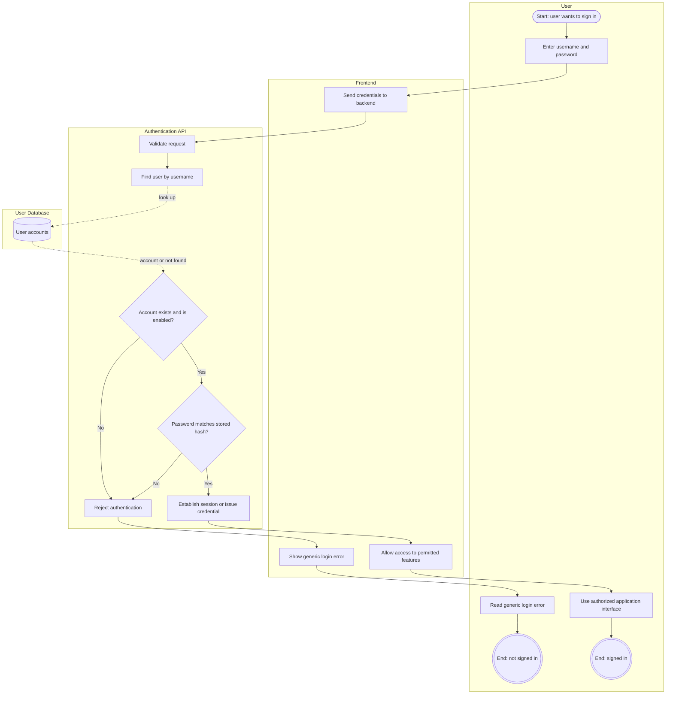
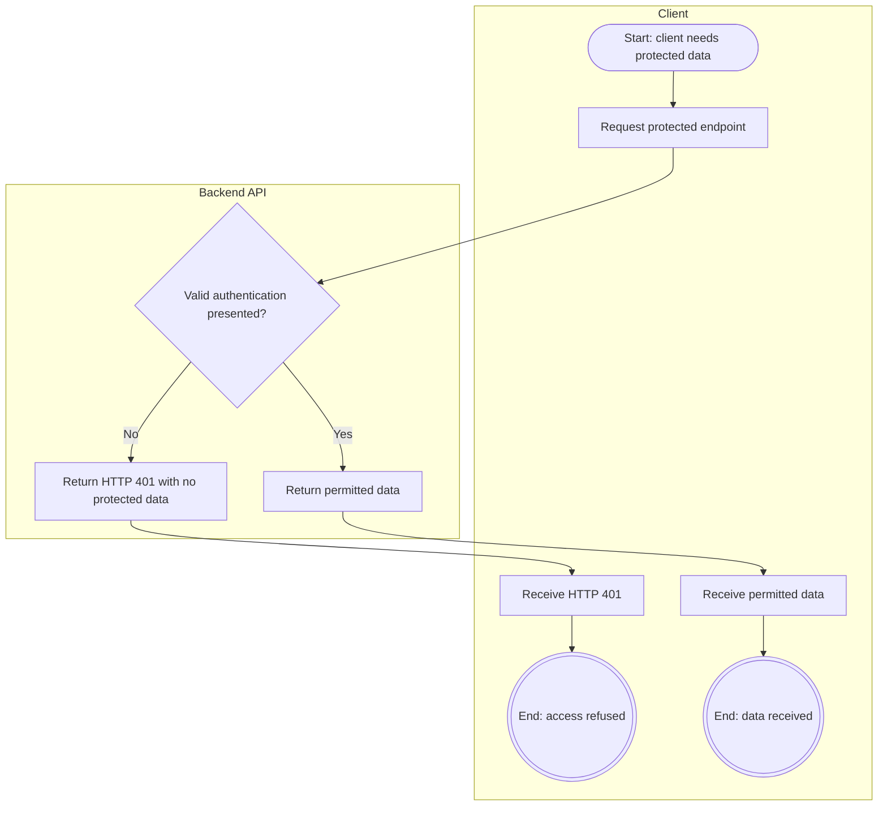

# US-01: User Authentication

## 1. Purpose

This behavioral model describes how HIVE should authenticate users, reject invalid login attempts, and deny unauthenticated access to protected API endpoints.

**Primary actor:** Registered user

**Supporting component:** HIVE backend and user database

## 2. Preconditions

- The user has an account, or the submitted username does not correspond to an existing account.
- The authentication service is available.
- User account information is stored securely.

## 3. Main Success Scenario

1. The user submits their credentials through the login interface.
2. The frontend sends the authentication request to the backend.
3. The backend validates the request.
4. The backend retrieves the corresponding account.
5. The backend verifies the password against the stored password hash and checks that the account is enabled.
6. The backend establishes an authenticated session or issues the configured authentication credential.
7. The frontend receives the authentication result and allows access to permitted features.

## 4. Alternative Scenarios

- Invalid credentials (incorrect username or password): authentication is rejected and a generic error message is shown.
- Unknown username: handled as invalid credentials; authentication is rejected with the same generic error message.
- Disabled account: authentication is denied, even if the submitted credentials are otherwise valid.
- Unauthenticated request to a protected endpoint: the backend returns HTTP 401 without exposing protected data.

Additional robustness cases (not required by the US-01 acceptance criteria):

- Invalid request: the backend rejects the request without authenticating the user.
- Authentication service failure: the user receives an appropriate error response.

Failed authentication must not grant access to protected endpoints. Error messages should not unnecessarily reveal whether a particular username exists.

## 5. Business Process Diagrams

**Notation:** Each box is a swimlane for one participant. Rounded shapes are start events, double circles are end events, rectangles are tasks, diamonds are decisions, and cylinders are data stores. Dotted arrows show data read from or written to a data store.

### 5.1 Login (Scenarios 1, 2 and 4)

### 5.2 Protected endpoint access (Scenario 3)

## 6. Acceptance Criteria Mapping

- Scenario 1: Successful login, shown in the login business process diagram (5.1).
- Scenario 2: Invalid credentials, covering an incorrect username (including an unknown account) or password, shown in the login business process diagram (5.1).
- Scenario 3: Unauthenticated API request, shown in the protected endpoint business process diagram (5.2).
- Scenario 4: Disabled account, shown in the login business process diagram (5.1).

The model is consistent with US-01.
