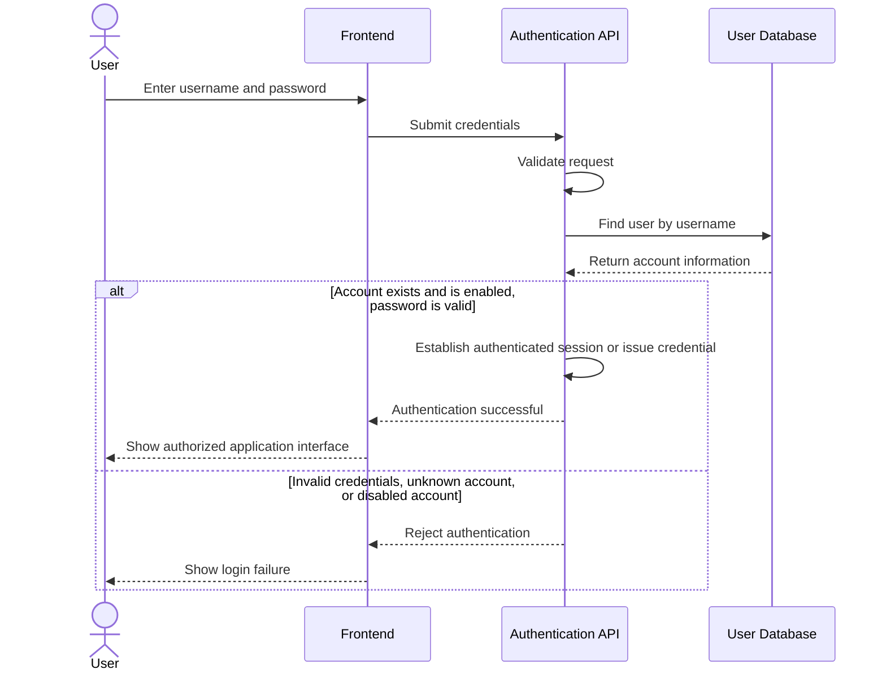

# US-01: User Authentication

## 1. Purpose

This behavioral model describes how HIVE should authenticate users and reject invalid login attempts.

**Primary actor:** Registered user

**Supporting component:** HIVE backend and user database

## 2. Preconditions

- The user has an account, or the submitted username does not correspond to an existing account.
- The authentication service is available.
- User account information is stored securely.

## 3. Main Success Scenario

1. The user submits their credentials through the login interface.
2. The frontend sends the authentication request to the backend.
3. The backend validates the request.
4. The backend retrieves the corresponding account.
5. The backend verifies the password against the stored password hash and checks that the account is enabled.
6. The backend establishes an authenticated session or issues the configured authentication credential.
7. The frontend receives the authentication result and allows access to permitted features.

## 4. Alternative Scenarios

- Invalid password: authentication is rejected.
- Unknown username: authentication is rejected.
- Disabled account: access is denied.
- Invalid request: the backend rejects the request without authenticating the user.
- Authentication service failure: the user receives an appropriate error response.

Failed authentication must not grant access to protected endpoints. Error messages should not unnecessarily reveal whether a particular username exists.

## 5. UML Sequence Diagram

## 6. Acceptance Criteria Mapping

- Scenario 1: Successful authentication.
- Scenario 2: Invalid credentials.
- Scenario 3: Unknown account.
- Scenario 4: Disabled account.

The model is consistent with US-01.
