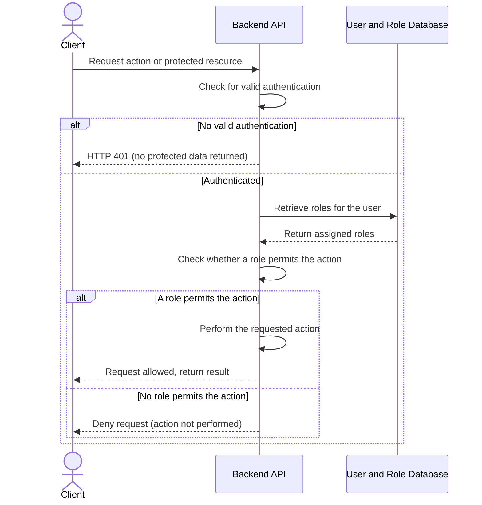

# US-02: Role-Based Authorization

## 1. Purpose

This behavioral model describes how HIVE enforces role-based access control: allowing actions permitted by a user's assigned roles, denying all other actions, and rejecting unauthenticated requests to protected resources.

**Primary actor:** Authenticated user

**Supporting component:** HIVE backend, and the user and role database

## 2. Preconditions

- Roles and the actions each role permits are defined.
- Users have roles assigned to them.
- The authentication mechanism from US-01 is available.

## 3. Main Success Scenario

1. The user requests an action or protected resource, presenting their authentication credential.
2. The backend verifies that the request is authenticated and identifies the user.
3. The backend retrieves the roles assigned to the user.
4. The backend checks whether at least one of the user's roles permits the requested action.
5. The backend allows the request and performs the action.
6. The backend returns the result to the user.

## 4. Alternative Scenarios

- Unauthorized action: the user is authenticated but has no role permitting the action. The backend denies the request (for example, with HTTP 403) and does not perform the restricted action.
- Unauthenticated request: the client has no valid authentication. The backend returns HTTP 401 and does not disclose protected data.

Additional robustness case (not required by the US-02 acceptance criteria):

- Role lookup failure: if the backend cannot determine the user's roles, it denies the request rather than allowing it.

Authorization must be checked by the backend on every protected request, regardless of what the frontend displays.

## 5. UML Sequence Diagram

### 5.1 Authorization of a protected request (Scenarios 1, 2 and 3)

## 6. Acceptance Criteria Mapping

- Scenario 1: Allow an authorized action, shown in the authorization sequence diagram (5.1).
- Scenario 2: Deny an unauthorized action, shown in the authorization sequence diagram (5.1).
- Scenario 3: Deny access to protected resources without authentication, shown in the authorization sequence diagram (5.1).

The model is consistent with US-02.
