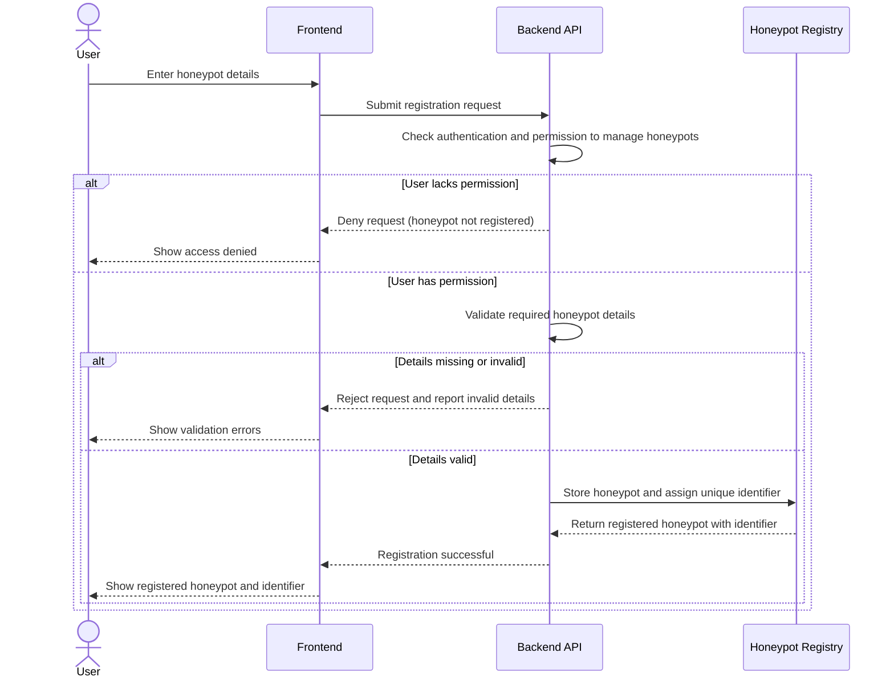

# US-03: Honeypot Registration and Management

## 1. Purpose

This behavioral model describes how HIVE registers a honeypot, rejects invalid registration details, and prevents users without permission from registering honeypots. The acceptance criteria for US-03 cover registration, so this model covers registration.

**Primary actor:** Administrator

**Supporting component:** HIVE backend and honeypot registry

## 2. Preconditions

- The administrator is authenticated and has permission to manage honeypots (see US-01 and US-02).
- The required honeypot details and their validation rules are defined.
- The honeypot registry storage is available.

## 3. Main Success Scenario

1. The administrator enters the honeypot details in the interface and submits the registration request.
2. The frontend sends the registration request to the backend.
3. The backend verifies that the user is authenticated and has permission to manage honeypots.
4. The backend validates the required honeypot details.
5. The backend stores the honeypot and assigns it a unique identifier.
6. The backend returns the registered honeypot, including its identifier.
7. The frontend shows the registration result to the administrator.

## 4. Alternative Scenarios

- Missing or invalid details: the backend rejects the request and reports that the supplied details are invalid. No honeypot is registered.
- Unauthorized user: an authenticated user without permission to manage honeypots is denied. The honeypot is not registered.

Additional robustness case (not required by the US-03 acceptance criteria):

- Storage failure: the backend returns an error response and the honeypot is not reported as registered.

## 5. UML Sequence Diagram

### 5.1 Honeypot registration (Scenarios 1, 2 and 3)

## 6. Acceptance Criteria Mapping

- Scenario 1: Register a honeypot, shown in the registration sequence diagram (5.1).
- Scenario 2: Reject invalid registration details, shown in the registration sequence diagram (5.1).
- Scenario 3: Prevent unauthorized registration, shown in the registration sequence diagram (5.1).

The model is consistent with US-03.
