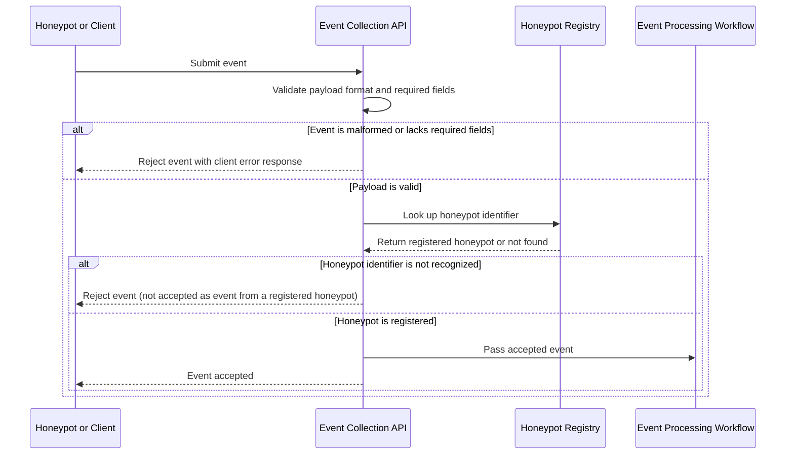

# US-04: Event Collection

## 1. Purpose

This behavioral model describes how HIVE accepts security events from registered honeypots, and rejects malformed events and events from unknown sources.

**Primary actor:** Registered honeypot

**Supporting component:** HIVE event collection API, honeypot registry and event-processing workflow

## 2. Preconditions

- For an event to be accepted, the submitting honeypot is registered with HIVE (see US-03).
- The expected event format and required fields are defined.
- The event collection endpoint is available.

## 3. Main Success Scenario

1. The honeypot submits an event to the event collection endpoint.
2. The backend validates that the payload is well formed and contains all required fields.
3. The backend checks the honeypot identifier against the registered honeypots.
4. The backend accepts the event.
5. The backend passes the accepted event to the event-processing workflow (US-05).
6. The backend acknowledges the submission to the honeypot.

## 4. Alternative Scenarios

- Malformed event: the payload is malformed or lacks required fields. The backend rejects the event and returns an appropriate client error response.
- Unknown event source: the honeypot identifier is not recognized. The backend rejects the event and does not accept it as an event from a registered honeypot.

Source validation depends on the honeypot registry created through US-03.

## 5. UML Sequence Diagram

### 5.1 Event submission (Scenarios 1, 2 and 3)

## 6. Acceptance Criteria Mapping

- Scenario 1: Accept a valid event, shown in the event submission sequence diagram (5.1).
- Scenario 2: Reject a malformed event, shown in the event submission sequence diagram (5.1).
- Scenario 3: Reject an unknown event source, shown in the event submission sequence diagram (5.1).

The model is consistent with US-04.
