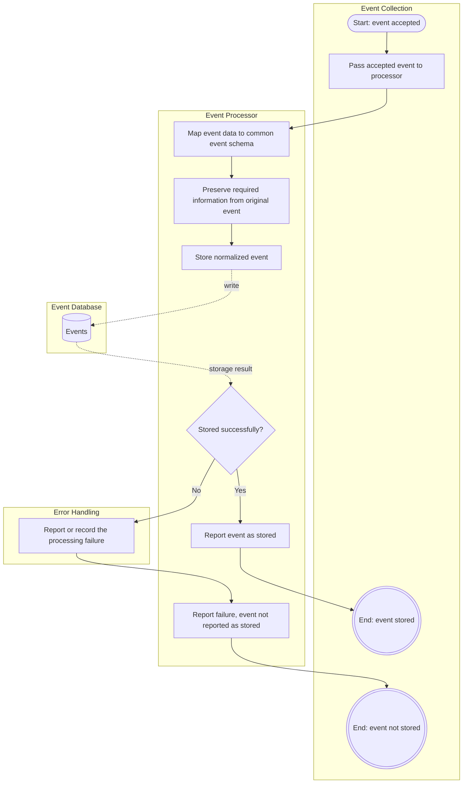

# US-05: Event Normalization and Storage

## 1. Purpose

This behavioral model describes how HIVE normalizes accepted events into a common schema, stores them, and handles storage failures, so that events from different honeypots can be searched and analyzed consistently.

**Primary actor:** HIVE event-processing workflow

**Supporting component:** HIVE database and error-handling mechanism

## 2. Preconditions

- HIVE has accepted a valid event (see US-04).
- The common event schema is defined.
- The configured database is available, except in the storage failure scenario.

## 3. Main Success Scenario

1. The event-processing workflow receives an accepted event.
2. The workflow maps the available event data to the common event schema.
3. The workflow preserves the required information from the original event.
4. The workflow stores the normalized event in the configured database.
5. The database confirms that the event was stored.
6. The stored event can be retrieved using the supported search functionality (see US-07).

## 4. Alternative Scenarios

- Storage failure: the database cannot store the normalized event. HIVE reports or records the failure through the defined error-handling mechanism and does not report the event as successfully stored.

Additional robustness case (not required by the US-05 acceptance criteria):

- Normalization failure: if an accepted event cannot be mapped to the common schema, the failure is handled through the same error-handling mechanism and the event is not reported as stored.

## 5. Business Process Diagram

**Notation:** Each box is a swimlane for one participant. Rounded shapes are start events, double circles are end events, rectangles are tasks, diamonds are decisions, and cylinders are data stores. Dotted arrows show data read from or written to a data store.

### 5.1 Normalization and storage (Scenarios 1, 2 and 3)

## 6. Acceptance Criteria Mapping

- Scenario 1: Normalize an accepted event, shown in the normalization and storage business process diagram (5.1).
- Scenario 2: Store a normalized event, shown in the normalization and storage business process diagram (5.1). Retrieval through search is covered by US-07.
- Scenario 3: Handle a storage failure, shown in the normalization and storage business process diagram (5.1).

The model is consistent with US-05.
