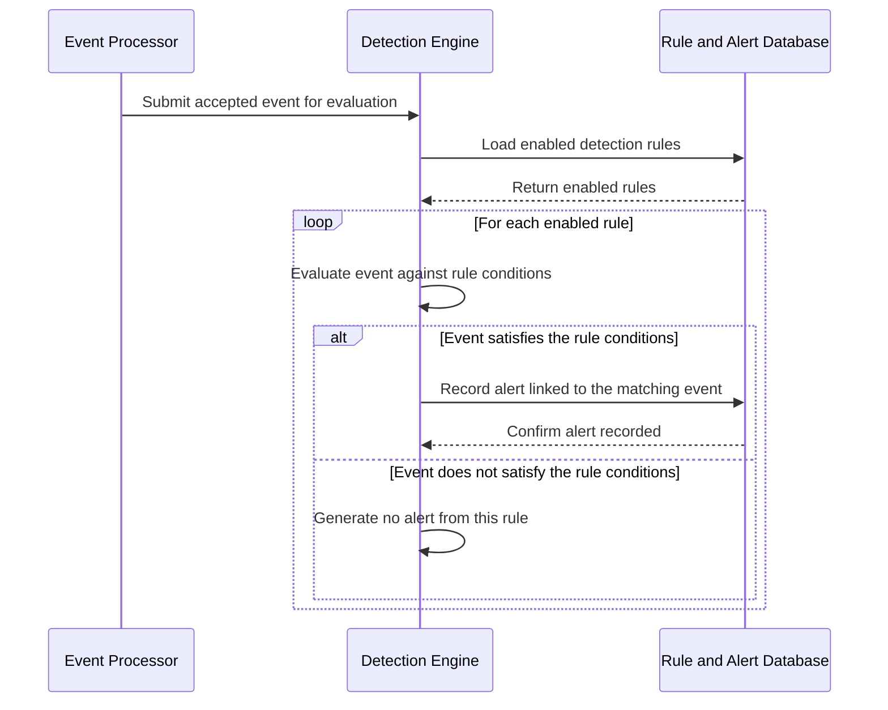
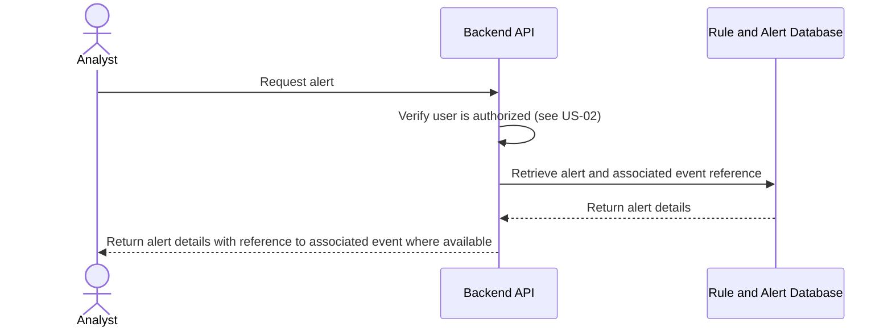

# US-06: Detection Rules and Alerts

## 1. Purpose

This behavioral model describes how HIVE evaluates accepted events against enabled detection rules, generates alerts for matching events, and lets authorized users retrieve alert information.

**Primary actor:** Security analyst

**Supporting component:** HIVE detection engine, detection rules, event store and alert store

## 2. Preconditions

- At least one detection rule is configured and enabled, with defined conditions.
- An accepted event is available for evaluation (see US-04 and US-05).
- Alert storage is available.

## 3. Main Success Scenario

1. An accepted event is submitted to the detection engine for evaluation.
2. The detection engine loads the enabled detection rules.
3. The engine evaluates the event against the conditions of each enabled rule.
4. For a rule whose conditions the event satisfies, the engine generates an alert associated with the matching event.
5. The engine records the alert details.
6. An authorized analyst later requests the alert.
7. HIVE verifies that the user is authorized and returns the alert's defined details, including a reference to the associated event where available.

## 4. Alternative Scenarios

- Non-matching event: the event does not satisfy a rule's conditions. HIVE does not generate an alert from that rule for the event.
- Disabled rule: a disabled rule is not evaluated and generates no alerts.

Users without permission to retrieve alerts are handled by role-based authorization (US-02).

## 5. UML Sequence Diagrams

### 5.1 Event evaluation and alert generation (Scenarios 1 and 2)

### 5.2 Alert retrieval (Scenario 3)

## 6. Acceptance Criteria Mapping

- Scenario 1: Generate an alert for a matching event, shown in the evaluation sequence diagram (5.1).
- Scenario 2: Do not generate an alert for a non-matching event, shown in the evaluation sequence diagram (5.1).
- Scenario 3: Preserve alert information, shown in the alert retrieval sequence diagram (5.2).

The model is consistent with US-06.
