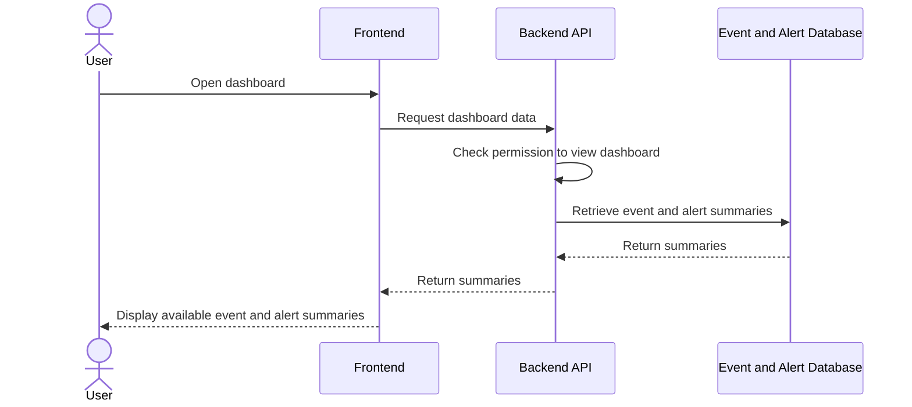
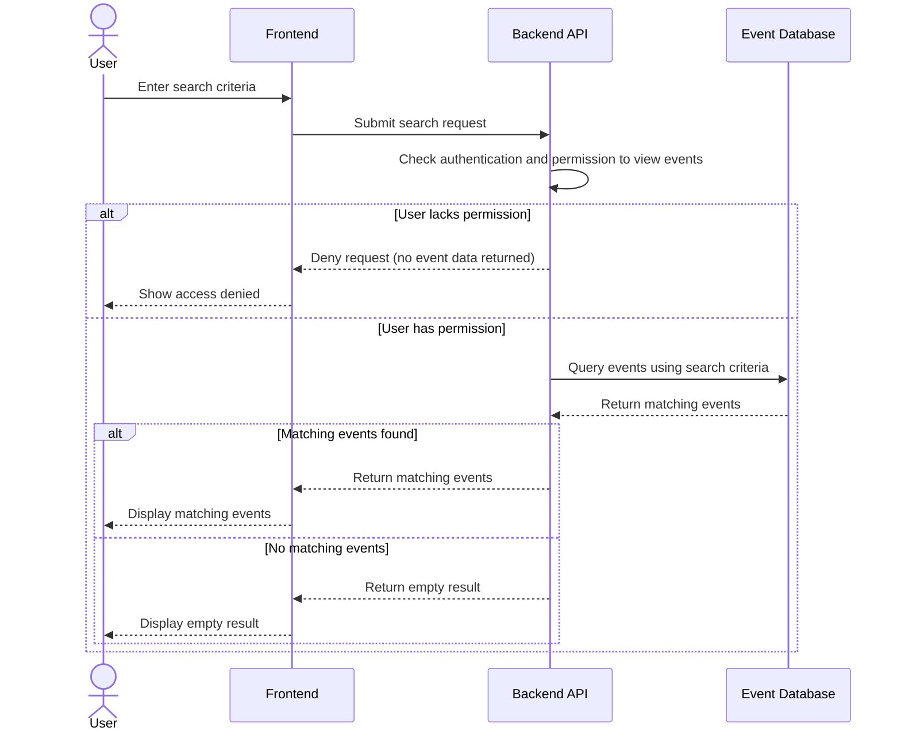

# US-07: Dashboard and Event Search

## 1. Purpose

This behavioral model describes how HIVE shows the dashboard to authorized users, searches stored events, returns empty results when nothing matches, and denies event access to users without permission.

**Primary actor:** Security analyst

**Supporting component:** HIVE frontend, backend and event and alert database

## 2. Preconditions

- The user is authenticated (see US-01).
- Permissions for viewing the dashboard and events are defined (see US-02).
- The supported search criteria are defined.
- Stored events exist for a search to return matches.

## 3. Main Success Scenario

1. The user opens the dashboard.
2. The frontend requests the dashboard data from the backend.
3. The backend verifies that the user has permission to view the dashboard.
4. The backend retrieves the available event and alert summaries.
5. The frontend displays the summaries.
6. The user submits a search using the supported search criteria.
7. The backend verifies that the user has permission to view events.
8. The backend queries the stored events and returns those matching the criteria.
9. The frontend displays the matching events.

## 4. Alternative Scenarios

- No results: a valid search matches no stored events. HIVE displays an empty result and does not present unrelated events as matches.
- Unauthorized event access: a user without permission to view events is denied. HIVE does not disclose the protected event data.

A user without permission to view the dashboard is handled by role-based authorization (US-02).

## 5. UML Sequence Diagrams

### 5.1 Viewing the dashboard (Scenario 1)

### 5.2 Searching events (Scenarios 2, 3 and 4)

## 6. Acceptance Criteria Mapping

- Scenario 1: View the dashboard, shown in the dashboard sequence diagram (5.1).
- Scenario 2: Search for events, shown in the search sequence diagram (5.2).
- Scenario 3: Return no results, shown in the search sequence diagram (5.2).
- Scenario 4: Deny unauthorized event access, shown in the search sequence diagram (5.2).

The model is consistent with US-07.
