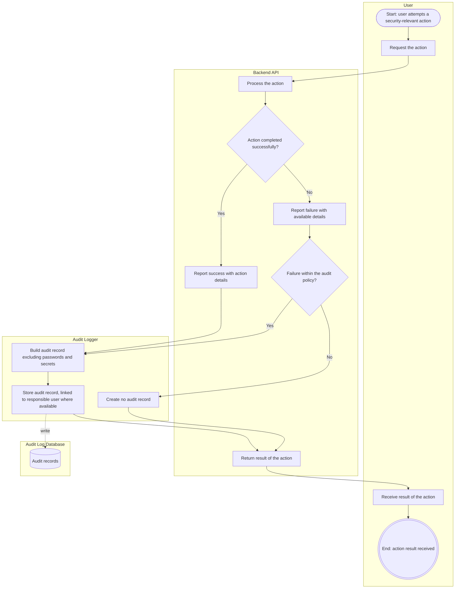
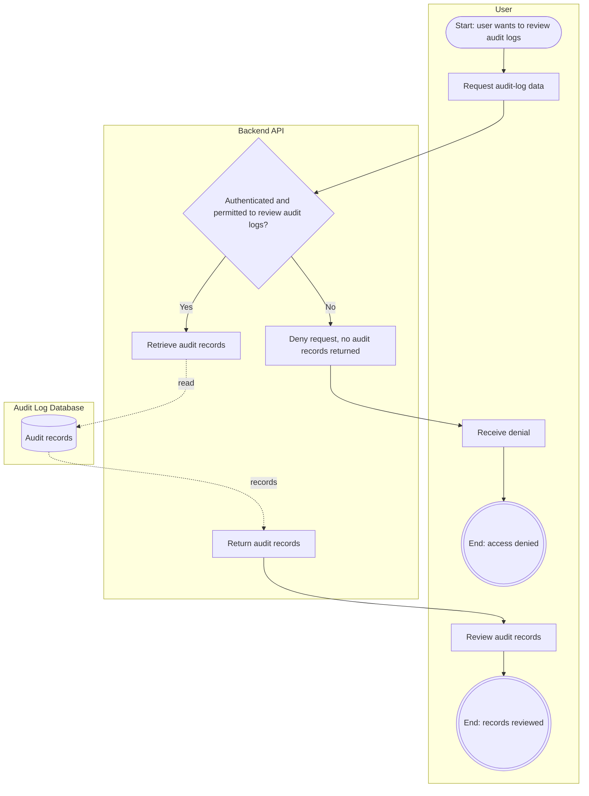

# US-08: Audit Logging

## 1. Purpose

This behavioral model describes how HIVE records security-relevant actions, whether they succeed or fail, keeps secrets out of audit records, and protects audit logs from users without permission to review them.

**Primary actor:** Authenticated user performing an action, and administrator reviewing audit logs

**Supporting component:** HIVE backend, audit logger and audit log database

## 2. Preconditions

- The security-relevant actions and the audit policy, including which failures are recorded, are defined.
- The details an audit record must contain are defined.
- Audit log storage is available.
- Permission to review audit logs is defined (see US-02).

## 3. Main Success Scenario

1. An authenticated user performs a defined security-relevant action.
2. The backend processes the action and it completes successfully.
3. The backend reports the action to the audit logger.
4. The audit logger creates an audit record containing the defined details and associates it with the responsible user where available.
5. The audit logger excludes passwords, authentication secrets and other prohibited secret values from the record.
6. The audit logger stores the record in the audit log database.

## 4. Alternative Scenarios

- Failed action: a user attempts a defined security-relevant action and it fails. HIVE records the failure when it falls within the audit policy, together with the available details needed for investigation.
- Unauthorized audit log access: a user without permission to review audit logs requests audit-log data. HIVE denies the request and does not disclose the audit records.

Secrets are never written to audit records, whether the action succeeded or failed.

## 5. Business Process Diagrams

**Notation:** Each box is a swimlane for one participant. Rounded shapes are start events, double circles are end events, rectangles are tasks, diamonds are decisions, and cylinders are data stores. Dotted arrows show data read from or written to a data store.

### 5.1 Recording audit records (Scenarios 1, 2 and 4)

### 5.2 Reviewing audit logs (Scenario 3)

## 6. Acceptance Criteria Mapping

- Scenario 1: Record a successful security-relevant action, shown in the recording business process diagram (5.1).
- Scenario 2: Record a failed security-relevant action, shown in the recording business process diagram (5.1).
- Scenario 3: Protect audit logs from unauthorized access, shown in the review business process diagram (5.2).
- Scenario 4: Avoid storing secrets in audit logs, shown in the recording business process diagram (5.1) at the step that builds the audit record.

The model is consistent with US-08.
