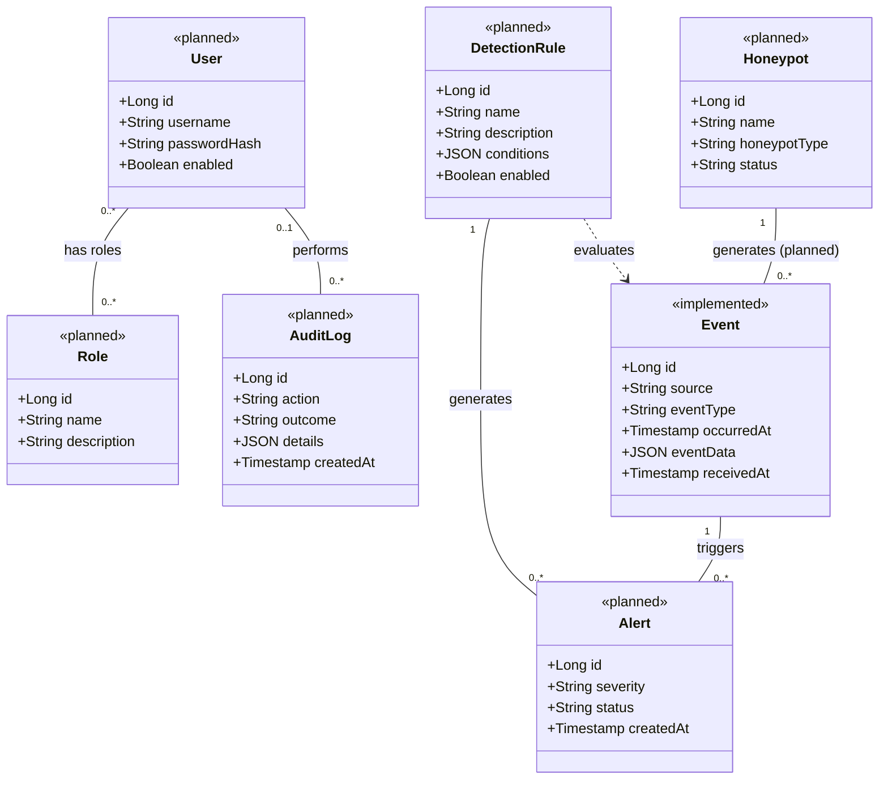

# HIVE Honeypot Network: Domain Model

## 1. Purpose

The domain model describes the main concepts in the HIVE Honeypot Network and how they relate to one another. It represents the planned system design rather than claiming that every feature has already been implemented.

HIVE is designed to collect security events from honeypots, store and analyze those events, identify potentially suspicious activity, and present relevant information to authorized users.

## 2. Main Domain Concepts

### User

Represents a person who accesses the HIVE application.

Responsibilities:
- Sign in to the application.
- Access features according to assigned roles.
- View events and alerts according to their permissions.

An account can be disabled, which prevents the user from signing in.

### Role

Represents a set of permissions assigned to a user.

Examples:
- Admin: manages users, honeypots and system configuration.
- Analyst: investigates collected events and alerts.

Permissions are initially defined per role in application code. They may become a separate concept in the future if they need to be managed at runtime.

### Honeypot

Represents a controlled decoy service that records activity from systems or clients interacting with it.

Examples:
- SSH honeypot.
- HTTP/web honeypot.
- Simulated API honeypot.

An administrator registers a honeypot, and HIVE assigns it a unique identifier. A registered honeypot generates security events that can be submitted to the HIVE backend.

### Event

Represents a recorded activity submitted to HIVE.

An event contains:
- A unique identifier.
- A source identifying the registered honeypot that submitted the event.
- An event type.
- The time the activity occurred.
- Event data containing additional details.
- The time HIVE received the event.

HIVE rejects events that are malformed or that come from an unrecognized source. Accepted events are normalized to a common schema before they are stored.

The current PostgreSQL implementation stores events in the `events` table, and the source is currently a plain text field.

### Detection Rule

Represents a condition used to identify events or patterns that may indicate suspicious activity.

A detection rule has defined conditions and can be enabled or disabled. Only enabled rules are evaluated against collected events. The exact format of the conditions has not been decided yet.

### Alert

Represents a notification generated when a detection rule identifies activity that requires attention.

An alert references the detection rule responsible for generating it and the event that triggered it. Initially, an alert references one event. Support for several events per alert may be added later.

### Audit Log

Represents a record of a security-relevant action performed within the application, such as signing in, a user-management change or a configuration change.

Audit logs record both successful and failed actions, along with the details needed for investigation. They never contain passwords, authentication secrets or other prohibited secret values. Audit logs are intended to support accountability and investigation, and only users with the appropriate permission can review them.

## 3. Relationships

- A user can have one or more roles, and a role can be assigned to multiple users.
- A honeypot can generate many events.
- Each event has one originating source, which identifies a registered honeypot once honeypots are registered in the database.
- A detection rule can evaluate many events, and an event may be evaluated by multiple rules. Evaluations are not stored. Only matches produce alerts.
- A detection rule can generate multiple alerts.
- An alert references one detection rule and one event in the initial design. An alert referencing several related events is a possible future extension.
- An audit log entry may be associated with a user. Some system-generated actions, or actions by users who cannot be identified, may not have an associated user.

## 4. UML Class Diagram

**Legend:** `<<implemented>>` marks a concept that exists in the current system. Only Event is implemented, as the `events` table. `<<planned>>` marks concepts that are part of the proposed design. The Honeypot to Event association is planned, because `events.source` is currently a plain text field.

**Notes on the diagram:**
- Attribute names use camelCase and correspond to the snake_case columns in the ER diagram. Foreign keys are shown as associations instead of attributes.
- A user can have many roles and a role can be assigned to many users. The `user_roles` table from the ER diagram is an implementation detail and is not shown as a class.
- There is no Permission class, because permissions are initially defined per role in application code.
- The audit log side of the User association is optional (`0..1`), because some actions are system-generated or the responsible user cannot be identified.
- The dashed arrow means a detection rule evaluates events. Evaluations are not stored, and only matches produce alerts.
- Each alert references one rule and one event in the initial design.

## 5. Current Implementation and Planned Design

The current PostgreSQL `events` table contains:

| Field | Purpose |
|---|---|
| `id` | Unique event identifier |
| `source` | Identifies the event source |
| `event_type` | Describes the type of event |
| `occurred_at` | Time the activity occurred |
| `event_data` | Additional event details stored as JSONB |
| `received_at` | Time the backend received the event |

The current implementation supports event submission and retrieval through the Go backend.

The concepts User, Role, Honeypot, Detection Rule, Alert, and Audit Log describe the broader planned system. The behavioral models for US-01 to US-08 likewise describe planned behavior. Of that behavior, only event submission and retrieval exist today.
