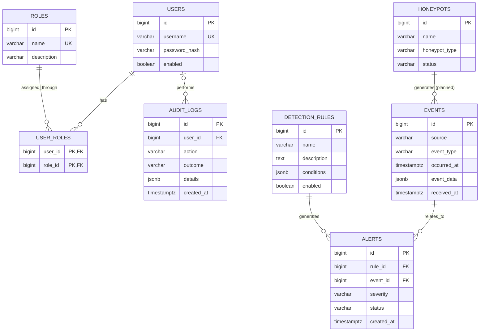

# HIVE Honeypot Network: Entity-Relationship Diagram

## 1. Introduction

The current implementation includes only the `events` table in PostgreSQL. The other entities in this diagram are proposed tables for future development, and the relationships that involve them are planned rather than enforced.

## 2. Proposed E-R Diagram

**Legend:** Only `EVENTS` is currently implemented in the database. All other entities are proposed. The `HONEYPOTS` to `EVENTS` relationship is planned and is not yet enforced, because `events.source` is currently a plain text field.

## 3. Entity Descriptions

| Entity | Status | Purpose |
|---|---|---|
| `users` | Proposed | Stores application accounts and password hashes. A disabled account cannot sign in. |
| `roles` | Proposed | Defines application roles, such as Admin and Analyst. |
| `user_roles` | Proposed | Implements the many-to-many relationship between users and roles. |
| `honeypots` | Proposed | Stores information about registered honeypot services. Each registered honeypot has a unique identifier. |
| `events` | Implemented | Stores normalized security events received by the backend. The `source` field identifies the honeypot that submitted the event. |
| `detection_rules` | Proposed | Defines conditions for identifying potentially suspicious activity. Only enabled rules are evaluated. |
| `alerts` | Proposed | Stores alerts associated with a detection rule and an event. |
| `audit_logs` | Proposed | Records security-relevant actions, both successful and failed, with the details needed for investigation. |

## 4. Relationship Explanations

- A user can have multiple roles, and each role can be assigned to multiple users. The `user_roles` table connects them.
- A honeypot can generate multiple events. Once the `honeypots` table exists, each event is planned to be associated with one registered honeypot.
- A detection rule can generate multiple alerts.
- Each alert references one detection rule and one event in this initial design.
- A user can perform multiple actions that are recorded in the audit logs. A system-generated log entry may have no associated user, so the user side of this relationship is optional.

## 5. Implementation Status and Design Notes

The existing PostgreSQL `events` table contains the fields shown in the diagram. The remaining tables are proposed additions and will be implemented before the corresponding relationships can be enforced by PostgreSQL.

**Event source.** The current `events.source` column is a text field, not a foreign key. It is intended to identify the registered honeypot that submitted the event. To enforce the planned relationship between `honeypots` and `events`, a future database migration will introduce a `honeypot_id` foreign key or an equivalent source-registration design.

**Alerts.** The proposed `alerts` table initially references exactly one event per alert. If a future alert needs to reference multiple events, an additional junction table such as `alert_events` may be required.

**Permissions.** Permissions are initially defined per role in application code, so the diagram has no separate permissions table. A `permissions` table, with a many-to-many link to roles, may be added later if permissions need to be managed at runtime.

**Detection rule conditions.** The `conditions` field is planned as structured JSON describing when a rule matches an event. The exact condition format has not been decided yet. Evaluations themselves are not stored. Only matches produce alert records.

**Audit logs.** An audit record stores the action, its outcome (success or failure) and the details available for investigation. Audit records must never contain passwords, authentication secrets or other prohibited secret values. The `user_id` is optional because some actions are system-generated, or the responsible user cannot be identified, for example after a failed sign-in.
