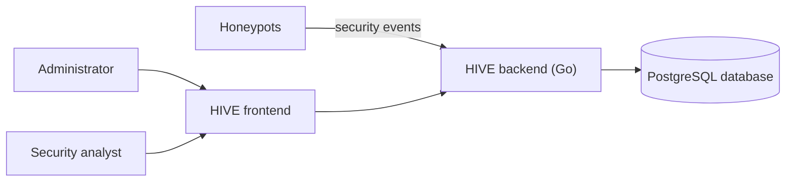
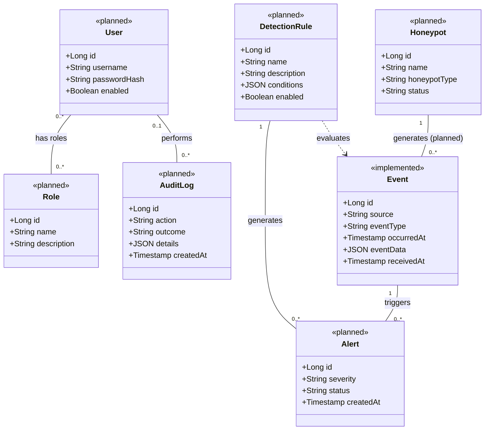
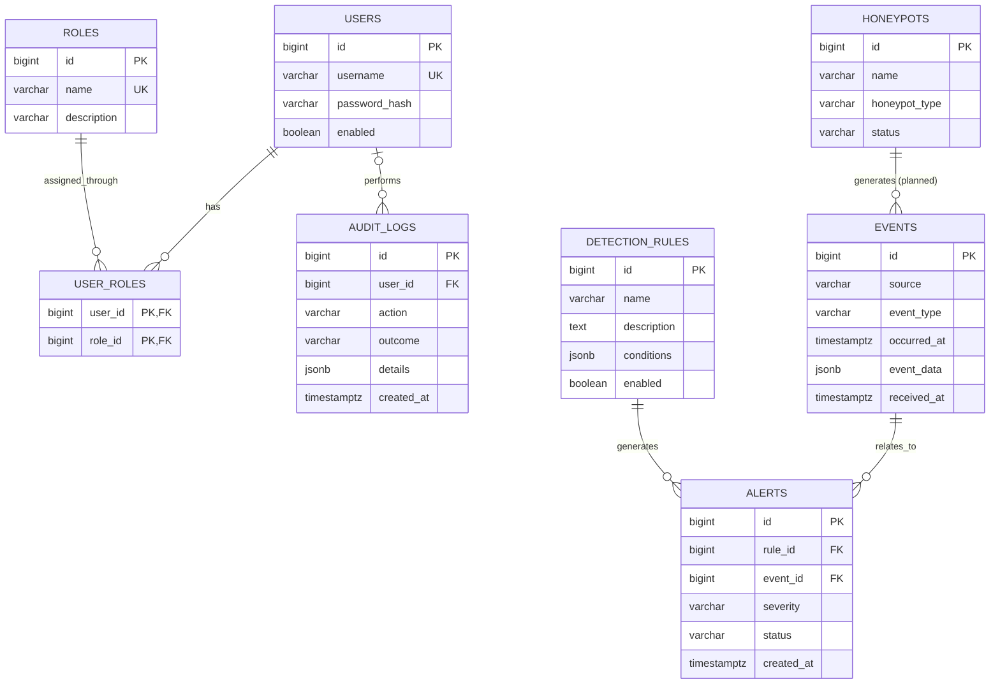

# HIVE Honeypot Network: Requirements Analysis Report

| | |
|---|---|
| **Project** | HIVE Honeypot Network |
| **Document** | Requirements Analysis Report |
| **Basis** | User stories US-01 to US-08, the behavioral models, the domain model and the entity-relationship diagram |

## 1. Introduction

### 1.1 Purpose

This report analyzes the requirements of the HIVE Honeypot Network. It turns the eight user stories into numbered functional and non-functional requirements, links each requirement to the domain model, the database design and the behavioral models, and records which parts of the system exist today and which are only specified.

### 1.2 Scope

The report covers the behavior defined by user stories US-01 to US-08: authentication, role-based authorization, honeypot registration, event collection, event normalization and storage, detection rules and alerts, dashboard and event search, and audit logging. It does not cover the internal implementation of individual honeypots or any feature that has no user story.

### 1.3 Status labels

Each requirement and user story carries one of three status labels.

| Label | Meaning |
|---|---|
| Implemented | The behavior exists in the current system. |
| Partially implemented | Part of the behavior exists. The remaining acceptance criteria are not yet implemented. |
| Specified | The behavior is defined in the user stories and models, and no implementation exists yet. |

The status basis is the current implementation: the `events` table in PostgreSQL, and event submission and retrieval through the Go backend. No other part of the specified behavior is implemented.

### 1.4 Source documents

| Document | Content |
|---|---|
| User stories US-01 to US-08 | Stories and acceptance criteria |
| Behavioral models US-01 to US-08 | Main scenario, alternative scenarios and business process diagrams per story |
| Domain model | Domain concepts, relationships and UML class diagram |
| Entity-relationship diagram | Proposed database design and implementation notes |

## 2. System Overview

### 2.1 Description

HIVE collects security events from honeypots, stores them in a common format, evaluates them against detection rules, and presents events and alerts to authorized users. Access is controlled through accounts and roles, and security-relevant actions are recorded in an audit log.

### 2.2 Actors

| Actor | Type | Role in the system |
|---|---|---|
| Administrator | Human user | Registers and manages honeypots, and manages users and system configuration. |
| Security analyst | Human user | Investigates collected events and alerts through the dashboard and event search. |
| Honeypot | External system | Submits security events to the HIVE backend. |

### 2.3 System context

The diagram shows the planned system context. The backend and database are the parts that exist today.

### 2.4 Technical constraints

- The backend is written in Go.
- The database is PostgreSQL. Event details are stored as JSONB and event times as `timestamptz`.

## 3. Current Status

### 3.1 What exists

- The `events` table with its six fields: `id`, `source`, `event_type`, `occurred_at`, `event_data` and `received_at`.
- Event submission and event retrieval through the Go backend.

### 3.2 Status by user story

| User story | Title | Status | Basis |
|---|---|---|---|
| US-01 | User Authentication | Specified | No `users` table or login flow exists. |
| US-02 | Role-Based Authorization | Specified | No `roles` or `user_roles` tables exist. |
| US-03 | Honeypot Registration and Management | Specified | No `honeypots` table exists. |
| US-04 | Event Collection | Partially implemented | Events can be submitted. Source validation needs the honeypot registry from US-03. |
| US-05 | Event Normalization and Storage | Partially implemented | Events are stored in the `events` table. Storage failure handling is specified only. |
| US-06 | Detection Rules and Alerts | Specified | No `detection_rules` or `alerts` tables exist. |
| US-07 | Dashboard and Event Search | Specified | Events can be retrieved through the backend. The dashboard, search criteria and permission checks are specified only. |
| US-08 | Audit Logging | Specified | No `audit_logs` table exists. |

Summary: 0 of 8 user stories are implemented, 2 are partially implemented, and 6 are specified only.

## 4. User Stories and Acceptance Criteria

| ID | Scenario | Expected outcome |
|---|---|---|
| US-01-S1 | Successful login | A user with an active account and valid credentials is authenticated and gets access to permitted features. |
| US-01-S2 | Invalid credentials | An incorrect username or password is denied with a generic error message. |
| US-01-S3 | Unauthenticated API request | A request to a protected endpoint without valid authentication returns HTTP 401 and no protected data. |
| US-01-S4 | Disabled account | A disabled account is denied even with otherwise valid credentials. |
| US-02-S1 | Allow an authorized action | A request is allowed when the user's role permits the action. |
| US-02-S2 | Deny an unauthorized action | A request is denied and the action is not performed when no role permits it. |
| US-02-S3 | Deny access without authentication | An unauthenticated request for a protected resource returns HTTP 401 and discloses no protected data. |
| US-03-S1 | Register a honeypot | An authorized administrator registers a honeypot with valid details, and it receives a unique identifier. |
| US-03-S2 | Reject invalid registration details | Missing or invalid fields are rejected and reported as invalid. |
| US-03-S3 | Prevent unauthorized registration | A user without permission is denied and the honeypot is not registered. |
| US-04-S1 | Accept a valid event | An event with all required fields from a registered honeypot is accepted and passed to event processing. |
| US-04-S2 | Reject a malformed event | A malformed event or one missing required fields is rejected with a client error response. |
| US-04-S3 | Reject an unknown event source | An event with an unrecognized honeypot identifier is rejected. |
| US-05-S1 | Normalize an accepted event | Event data is mapped to the common event schema and the required original information is preserved. |
| US-05-S2 | Store a normalized event | The event is stored and can be retrieved through search. |
| US-05-S3 | Handle a storage failure | The failure is reported or recorded through the error-handling mechanism, and the event is not reported as stored. |
| US-06-S1 | Generate an alert for a matching event | An enabled rule whose conditions the event satisfies produces a recorded alert linked to the event. |
| US-06-S2 | No alert for a non-matching event | No alert is generated from a rule whose conditions the event does not satisfy. |
| US-06-S3 | Preserve alert information | An authorized user retrieves the alert's details, with a reference to the associated event where available. |
| US-07-S1 | View the dashboard | An authorized user sees the available event and alert summaries. |
| US-07-S2 | Search for events | A search with supported criteria returns the matching events. |
| US-07-S3 | Return no results | A valid search with no matches returns an empty result and no unrelated events. |
| US-07-S4 | Deny unauthorized event access | A user without permission is denied and no event data is disclosed. |
| US-08-S1 | Record a successful action | A security-relevant action creates an audit record with the defined details, linked to the responsible user where available. |
| US-08-S2 | Record a failed action | A failure within the audit policy is recorded with the details needed for investigation. |
| US-08-S3 | Protect audit logs | A user without permission is denied and no audit records are disclosed. |
| US-08-S4 | Avoid storing secrets | Audit records never contain passwords, authentication secrets or other prohibited secret values. |

## 5. Functional Requirements

### 5.1 Authentication (US-01)

| ID | Requirement | Source | Status |
|---|---|---|---|
| FR-01 | The system shall authenticate a user who submits valid credentials for an active account and grant access to the features permitted for that account. | US-01-S1 | Specified |
| FR-02 | The system shall verify the submitted password against the stored password hash. | US-01-S1 | Specified |
| FR-03 | The system shall deny access when the username or password is incorrect and show a generic error message that does not reveal whether the username exists. | US-01-S2 | Specified |
| FR-04 | The system shall deny authentication for a disabled account even when the credentials are otherwise valid. | US-01-S4 | Specified |
| FR-05 | The system shall return HTTP 401 and disclose no protected data when a client without valid authentication requests a protected endpoint. | US-01-S3, US-02-S3 | Specified |

### 5.2 Authorization (US-02)

| ID | Requirement | Source | Status |
|---|---|---|---|
| FR-06 | The system shall allow a user to hold one or more roles, and a role to be assigned to many users. | US-02, domain model | Specified |
| FR-07 | The system shall allow a request from an authenticated user when at least one of the user's roles permits the action. | US-02-S1 | Specified |
| FR-08 | The system shall deny a request, and not perform the action, when none of the user's roles permits it. | US-02-S2 | Specified |
| FR-09 | The system shall check authorization in the backend on every protected request. | US-02 behavioral model | Specified |

### 5.3 Honeypot registration (US-03)

| ID | Requirement | Source | Status |
|---|---|---|---|
| FR-10 | The system shall let an authorized administrator register a honeypot and shall assign it a unique identifier. | US-03-S1 | Specified |
| FR-11 | The system shall reject a registration with missing or invalid required fields and report that the details are invalid. | US-03-S2 | Specified |
| FR-12 | The system shall deny registration to a user without permission to manage honeypots and shall not register the honeypot. | US-03-S3 | Specified |

### 5.4 Event collection (US-04)

| ID | Requirement | Source | Status |
|---|---|---|---|
| FR-13 | The system shall accept an event from a registered honeypot that contains all required fields in the expected format and pass it to event processing. | US-04-S1 | Partially implemented |
| FR-14 | The system shall reject a malformed event, or one that lacks required fields, with a client error response. | US-04-S2 | Specified |
| FR-15 | The system shall reject an event with an unrecognized honeypot identifier and shall not accept it as an event from a registered honeypot. | US-04-S3 | Specified |

### 5.5 Event normalization and storage (US-05)

| ID | Requirement | Source | Status |
|---|---|---|---|
| FR-16 | The system shall map the data of an accepted event to the common event schema and preserve the required information from the original event. | US-05-S1 | Partially implemented |
| FR-17 | The system shall store normalized events in the configured database and make them retrievable through the supported search functionality. | US-05-S2 | Partially implemented |
| FR-18 | When the database cannot store a normalized event, the system shall report or record the failure through the defined error-handling mechanism and shall not report the event as stored. | US-05-S3 | Specified |

### 5.6 Detection rules and alerts (US-06)

| ID | Requirement | Source | Status |
|---|---|---|---|
| FR-19 | The system shall evaluate each accepted event against every enabled detection rule. | US-06-S1, US-06-S2 | Specified |
| FR-20 | The system shall generate an alert, linked to the event, and record its details when an enabled rule's conditions are satisfied. | US-06-S1 | Specified |
| FR-21 | The system shall not generate an alert from a rule for an event that does not satisfy the rule's conditions. | US-06-S2 | Specified |
| FR-22 | The system shall let an authorized user retrieve an alert's defined details, including a reference to the associated event where available. | US-06-S3 | Specified |

### 5.7 Dashboard and event search (US-07)

| ID | Requirement | Source | Status |
|---|---|---|---|
| FR-23 | The system shall show event and alert summaries on a dashboard to users with permission to view it. | US-07-S1 | Specified |
| FR-24 | The system shall return the events that match the supported search criteria to users with permission to view events. | US-07-S2 | Specified |
| FR-25 | The system shall show an empty result, and no unrelated events, when a valid search matches no stored events. | US-07-S3 | Specified |
| FR-26 | The system shall deny event requests from users without permission to view events and shall not disclose event data. | US-07-S4 | Specified |

### 5.8 Audit logging (US-08)

| ID | Requirement | Source | Status |
|---|---|---|---|
| FR-27 | The system shall create an audit record with the defined details for each successful security-relevant action, linked to the responsible user where available. | US-08-S1 | Specified |
| FR-28 | The system shall record a failed security-relevant action when it falls within the audit policy, with the details needed for investigation. | US-08-S2 | Specified |
| FR-29 | The system shall deny audit-log requests from users without permission to review audit logs and shall not disclose the records. | US-08-S3 | Specified |
| FR-30 | The system shall not store passwords, authentication secrets or other prohibited secret values in audit records. | US-08-S4 | Specified |

Summary: of 30 functional requirements, 3 are partially implemented (FR-13, FR-16, FR-17) and 27 are specified only.

## 6. Non-Functional Requirements

| ID | Category | Requirement | Source | Status |
|---|---|---|---|---|
| NFR-01 | Security | The system shall store user passwords only as hashes. | US-01 preconditions, ER diagram (`users.password_hash`) | Specified |
| NFR-02 | Data integrity | Every entity shall have a unique identifier, and relationships between tables shall be enforced by PostgreSQL foreign keys once the tables exist. | ER diagram | Partially implemented |
| NFR-03 | Reliability | The system shall never report an event as stored unless it has been persisted. | US-05-S3 | Specified |
| NFR-04 | Flexibility | Event-specific details shall be stored as JSONB so that events from different honeypot types fit one common schema. | ER diagram, domain model | Implemented |
| NFR-05 | Data quality | Event times (`occurred_at`, `received_at`) shall be stored with time zone information. | ER diagram | Implemented |
| NFR-06 | Extensibility | The design shall allow later additions without redesign: a `honeypot_id` foreign key on events, an `alert_events` junction table, and a `permissions` table. | ER diagram design notes | Specified |

Performance, availability and data retention targets have not been defined yet. They are listed as open issues in section 10.

## 7. Domain Analysis

### 7.1 Domain concepts

| Concept | Description | Status |
|---|---|---|
| User | A person who accesses HIVE. An account can be disabled, which prevents sign-in. | Specified |
| Role | A set of permissions assigned to users, for example Admin and Analyst. Permissions are initially defined per role in application code. | Specified |
| Honeypot | A controlled decoy service that generates security events. An administrator registers it and it receives a unique identifier. | Specified |
| Event | A recorded activity submitted to HIVE, with a source identifying the registered honeypot, an event type, timestamps and event data. | Implemented |
| Detection Rule | A condition for identifying suspicious activity. It can be enabled or disabled, and only enabled rules are evaluated. | Specified |
| Alert | A notification generated when a rule matches an event. It references one rule and one event in the initial design. | Specified |
| Audit Log | A record of a security-relevant action, successful or failed, that never contains secrets. | Specified |

### 7.2 UML class diagram

Only Event is implemented. The Honeypot to Event association is planned, because `events.source` is currently a plain text field. Evaluations of rules against events are not stored, and only matches produce alerts.

## 8. Data Requirements

### 8.1 Entity-relationship diagram

### 8.2 Table status

| Table | Status | Supports |
|---|---|---|
| `events` | Implemented | US-04, US-05, US-06, US-07 |
| `users` | Specified | US-01, US-02, US-08 |
| `roles` | Specified | US-02, US-03, US-07, US-08 |
| `user_roles` | Specified | US-02 |
| `honeypots` | Specified | US-03, US-04 |
| `detection_rules` | Specified | US-06 |
| `alerts` | Specified | US-06, US-07 |
| `audit_logs` | Specified | US-08 |

### 8.3 Design decisions recorded in the data model

- **Event source.** `events.source` is a text field. It is intended to identify the registered honeypot. Enforcing the relationship needs a migration that adds a `honeypot_id` foreign key or an equivalent source-registration design.
- **Alerts.** Each alert references exactly one event. An `alert_events` junction table can be added if an alert needs several events.
- **Permissions.** Permissions are defined per role in application code. A `permissions` table is not part of the current design.
- **Rule conditions.** `detection_rules.conditions` is structured JSON. The condition format is not decided.
- **Audit logs.** `audit_logs.user_id` is optional, because some actions are system-generated or the user cannot be identified, for example after a failed sign-in.

## 9. Behavioral Analysis

Each user story has a behavioral model with a main success scenario, alternative scenarios, one or more business process diagrams and a mapping from acceptance criteria to diagrams.

| Model | Diagrams | Main decision points |
|---|---|---|
| US-01 | Login. Protected endpoint access. | Account exists and is enabled. Password matches the stored hash. Valid authentication presented. |
| US-02 | Authorization of a protected request. | Valid authentication presented. A role permits the action. |
| US-03 | Honeypot registration. | User permitted to manage honeypots. Required details valid. |
| US-04 | Event submission. | Payload well formed. Honeypot registered. |
| US-05 | Normalization and storage. | Event stored successfully. |
| US-06 | Event evaluation and alert generation. Alert retrieval. | Rule conditions satisfied. User authorized to retrieve alerts. |
| US-07 | Viewing the dashboard. Searching events. | User permitted to view the dashboard or events. Matching events found. |
| US-08 | Recording audit records. Reviewing audit logs. | Action succeeded. Failure within the audit policy. User permitted to review audit logs. |

All 27 acceptance scenarios map to at least one diagram.

## 10. Traceability Matrix

| User story | Functional requirements | Domain concepts | ER tables | Behavioral model | Status |
|---|---|---|---|---|---|
| US-01 | FR-01 to FR-05 | User | `users` | `us-01-user-authentication-bpd.md` | Specified |
| US-02 | FR-05 to FR-09 | User, Role | `users`, `roles`, `user_roles` | `us-02-role-based-authorization-bpd.md` | Specified |
| US-03 | FR-10 to FR-12 | Honeypot, User, Role | `honeypots`, `users`, `roles` | `us-03-honeypot-registration-management-bpd.md` | Specified |
| US-04 | FR-13 to FR-15 | Honeypot, Event | `events`, `honeypots` | `us-04-event-collection-bpd.md` | Partially implemented |
| US-05 | FR-16 to FR-18 | Event | `events` | `us-05-event-normalization-storage-bpd.md` | Partially implemented |
| US-06 | FR-19 to FR-22 | Detection Rule, Alert, Event | `detection_rules`, `alerts`, `events` | `us-06-detection-rules-alerts-bpd.md` | Specified |
| US-07 | FR-23 to FR-26 | Event, Alert, User, Role | `events`, `alerts`, `users`, `roles` | `us-07-dashboard-event-search-bpd.md` | Specified |
| US-08 | FR-27 to FR-30 | Audit Log, User | `audit_logs`, `users` | `us-08-audit-logging-bpd.md` | Specified |

## 11. Open Issues

| No. | Issue | Affects | Current handling |
|---|---|---|---|
| 1 | US-06-S3 says the alert includes an event reference "where available", but `alerts.event_id` is mandatory in the ER diagram. | US-06, ER diagram | The ER diagram requires one event per alert. The criterion wording or the relationship needs to change so they agree. |
| 2 | No user story covers how a honeypot proves its identity when submitting events. US-04 only checks the honeypot identifier. | US-04, US-03 | Not specified. Any client that knows a registered identifier could submit events. |
| 3 | The US-03 title mentions management, but the acceptance criteria cover registration only. | US-03 | Updating and disabling honeypots are not specified. |
| 4 | The response code for an authenticated but unauthorized request is not defined. Only HTTP 401 is fixed by the criteria. | US-02, US-03, US-07, US-08 | The behavioral models use HTTP 403 as an example. |
| 5 | Whether login creates a session or issues a token is not decided. | US-01 | The model says "session or configured credential". |
| 6 | The format of detection rule conditions is not decided. | US-06 | The `conditions` field is JSON. |
| 7 | Permissions have no table, so they cannot be changed without a code change. | US-02 | Permissions are defined per role in application code. |
| 8 | The audit policy is not defined: which actions are security-relevant, which failures are recorded, and which details an audit record contains. | US-08 | The behavioral model refers to "the defined policy" without listing it. |
| 9 | The supported search criteria are not defined. | US-07 | The behavioral model refers to "supported search criteria". |
| 10 | No performance, availability or data retention targets exist. | All | No non-functional targets are set beyond section 6. |

## Appendix A. Document list

| File | Content |
|---|---|
| `requirements-analysis.md` | This report |
| `hive-domain-model.md` | Domain model with UML class diagram |
| `hive-er-diagram.md` | Entity-relationship diagram and design notes |
| `US-01-authentication-bpd.md` | Behavioral model for US-01 |
| `US-02-authorization-bpd.md` | Behavioral model for US-02 |
| `US-03-honeypot-registration-bpd.md` | Behavioral model for US-03 |
| `US-04-event-collection-bpd.md` | Behavioral model for US-04 |
| `US-05-event-storage-bpd.md` | Behavioral model for US-05 |
| `Us-06-detection-rules-alerts-bpd.md` | Behavioral model for US-06 |
| `Us-07-dashboard-event-search-bpd.md` | Behavioral model for US-07 |
| `Us-08-audit-logging-bpd.md` | Behavioral model for US-08 |
