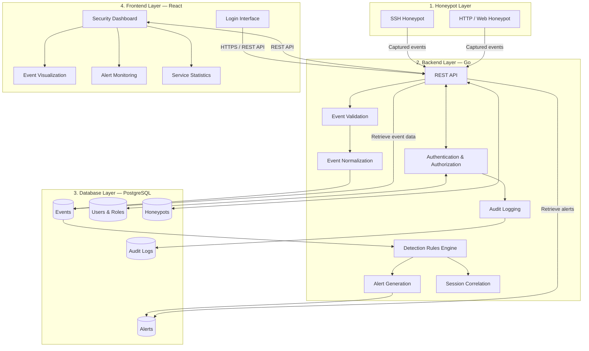

# HIVE Honeypot Network: System Architecture

## 1. Overview

The HIVE Honeypot Network follows a modular client-server architecture consisting of a honeypot layer, backend processing layer, database layer, and frontend dashboard.

The system collects activity from deployed honeypots, processes and stores captured events, analyzes suspicious activity, and presents security information through a centralized web dashboard.

The backend is implemented using Go and exposes REST API endpoints, while PostgreSQL provides persistent data storage and React is used for the frontend interface.

## 2. Architecture Diagram

## 3. Component Responsibilities

| Component | Responsibility |
|---|---|
| SSH Honeypot | Captures suspicious SSH activity and interactions. |
| HTTP/Web Honeypot | Captures suspicious web requests and interactions. |
| Go REST API | Provides communication between the frontend, honeypots, and backend services. |
| Authentication & Authorization | Handles user authentication and access permissions. |
| Event Validation | Checks incoming event data for validity and completeness. |
| Event Normalization | Converts captured events into a common format. |
| Detection Rules Engine | Evaluates events against predefined detection rules. |
| Alert Generation | Creates alerts when suspicious activity is detected. |
| Session Correlation | Groups related events into sessions where possible. |
| Audit Logging | Records important system and user operations. |
| PostgreSQL | Provides persistent storage for system data. |
| React Dashboard | Displays events, alerts, attacker information, and statistics. |

## 4. Data Flow

1. Honeypots capture suspicious activity and send event data to the Go REST API.
2. The backend validates incoming event data.
3. Valid events are normalized into a common event structure.
4. Normalized events are stored in PostgreSQL.
5. The detection engine evaluates stored events against configured detection rules.
6. When suspicious activity is identified, the system generates alerts.
7. The frontend communicates with the REST API to retrieve events, alerts, and statistics.
8. Authentication, authorization, and audit logging support secure system operation.

## 5. Design Considerations

- **Modularity:** Backend responsibilities are separated into logical components to support maintainability.
- **Extensibility:** The common event structure allows additional honeypot types to be integrated without redesigning the entire system.
- **Security:** Authentication, role-based authorization, and audit logging provide security controls.
- **Scalability:** The REST API and modular processing components allow additional functionality to be introduced as the system grows.
- **Data Integrity:** PostgreSQL provides structured and persistent storage for collected security events.

## 6. Implementation Status

The architecture represents the intended overall HIVE system design. The Go backend, REST API, PostgreSQL connection, and initial event storage functionality have been implemented. Other components, including the React dashboard, authentication, detection engine, and additional security-analysis functionality, are planned development components.
