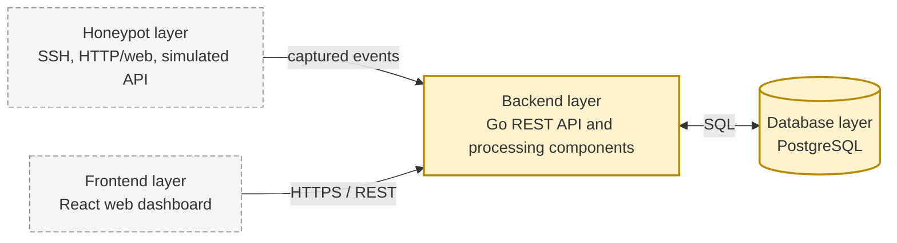
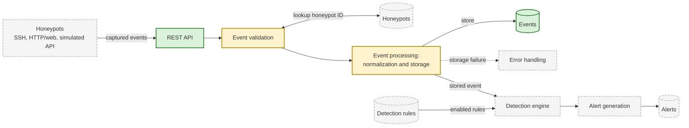
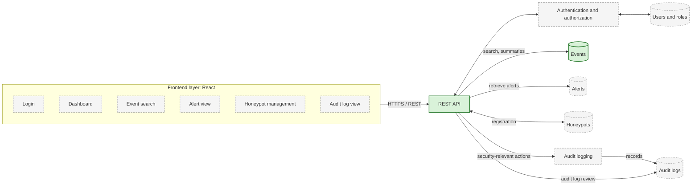

# HIVE Honeypot Network: System Architecture

## 1. Overview

The HIVE Honeypot Network uses a layered client-server architecture with four layers: a honeypot layer, a backend layer, a database layer and a frontend layer.

Honeypots capture activity and send security events to the backend. The backend validates, normalizes and stores the events, evaluates them against detection rules and generates alerts. Authorized users view events and alerts through a web dashboard. The backend is written in Go and exposes a REST API, PostgreSQL provides persistent storage, and React is used for the frontend.

**Implementation status.** The Go backend, the REST API, the PostgreSQL connection and initial event storage are implemented. All other components are planned: the React dashboard, authentication and authorization, the detection engine, alert generation, audit logging and the honeypot registry. The diagrams in this document mark each component with its status, and section 2 lists them.

The components are logical modules of the Go backend.

## 2. Component Status

| Status | Meaning | Diagram style |
|---|---|---|
| Implemented | The component exists in the current system. | Green, solid border |
| Partially implemented | Part of the component exists. | Amber, solid border |
| Planned | The component is designed but not built. | Grey, dashed border |

| Layer | Component | Status |
|---|---|---|
| Backend | REST API | Implemented |
| Backend | Event processing (normalization and storage) | Partially implemented: events are stored, and the remaining behavior is planned |
| Backend | Authentication and authorization | Planned |
| Backend | Event validation | Partially implemented: basic payload validation exists; honeypot registry validation is planned |
| Backend | Detection engine | Planned |
| Backend | Alert generation | Planned |
| Backend | Audit logging | Planned |
| Backend | Error handling | Planned |
| Database | Events | Implemented |
| Database | Users and roles, Honeypots, Detection rules, Alerts, Audit logs | Planned |
| Frontend | All React components | Planned |
| Honeypot | All honeypot types | Planned |

## 3. Architecture Diagrams

### 3.1 Layers

The backend and database layers are partially implemented. The honeypot and frontend layers are planned.

### 3.2 Event pipeline: collection, processing and detection

### 3.3 User access, administration and auditing

## 4. Component Responsibilities

| Component | Responsibility | User stories |
|---|---|---|
| Honeypots (SSH, HTTP/web, simulated API) | Capture suspicious activity and submit it as events to the REST API. | US-04 |
| REST API | Single entry point for honeypots and the frontend. Routes requests to the backend components. | All |
| Authentication and authorization | Authenticates users, rejects disabled accounts, returns HTTP 401 for unauthenticated requests, and checks role permissions on every protected request. | US-01, US-02 |
| Event validation | Rejects malformed events and events whose honeypot identifier is not in the honeypot registry. | US-04 |
| Event processing | Maps accepted events to the common event schema, stores them, and does not report an event as stored unless it was persisted. | US-05 |
| Error handling | Reports or records processing failures, such as a database that cannot store an event. | US-05 |
| Detection engine | Evaluates a stored event against every enabled detection rule. | US-06 |
| Alert generation | Records an alert, linked to the event, when a rule's conditions are satisfied. | US-06 |
| Audit logging | Records security-relevant actions, successful and failed, without passwords or other secrets. | US-08 |
| Honeypot registry (Honeypots store) | Holds registered honeypots and their unique identifiers. | US-03, US-04 |
| Dashboard, event search, alert view | Show event and alert summaries, search results and alert details to authorized users. | US-06, US-07 |
| Honeypot management | Lets an authorized administrator register honeypots. | US-03 |
| Audit log view | Lets an authorized user review audit records. | US-08 |
| Login | Collects credentials and sends them to the REST API. | US-01 |
| PostgreSQL | Provides persistent storage. The tables are listed in the ER diagram. | All |

## 5. Data Flow

### 5.1 Event collection and detection

1. A honeypot submits a captured event to the REST API.
2. Event validation checks that the payload is well formed and has all required fields. A malformed event is rejected with a client error response.
3. Event validation checks the honeypot identifier against the honeypot registry. An unrecognized identifier is rejected.
4. Event processing normalizes the accepted event to the common event schema and stores it in the Events table. If the database cannot store it, error handling reports or records the failure and the event is not reported as stored.
5. After the event is stored, it is passed to the detection engine, which loads the enabled detection rules and evaluates the event against each one.
6. For each rule whose conditions the event satisfies, alert generation records an alert linked to the event. A rule that the event does not satisfy produces no alert.

### 5.2 User access

1. A user signs in through the login interface, and the REST API sends the credentials to authentication and authorization.
2. Authentication checks the password against the stored hash and refuses a disabled account. Failures show a generic error message.
3. For each protected request, the backend returns HTTP 401 if there is no valid authentication. If the user is authenticated but no role permits the action, the backend denies it and does not perform the action.
4. For permitted requests, the REST API reads events and alerts from the database and returns summaries, search results or alert details. A search with no matches returns an empty result.

### 5.3 Administration and auditing

1. An administrator submits a honeypot registration through honeypot management. The backend checks the permission and validates the details. It then stores the honeypot and assigns it a unique identifier.
2. Security-relevant actions, successful or failed, are reported to audit logging, which stores an audit record without passwords or other secrets.
3. A user with permission to review audit logs reads them through the audit log view. Everyone else is denied and sees no records.

## 6. Technology Choices

| Area | Choice |
|---|---|
| Backend | Go, exposing a REST API |
| Database | PostgreSQL, with JSONB for event details and timestamptz for event times |
| Frontend | React web application |
| Frontend to backend | HTTPS and REST |

## 7. Design Considerations

- **Modularity.** Backend responsibilities are split into logical components, each matching one step in the behavioral models.
- **Extensibility.** The common event schema keeps honeypot-specific details in a JSONB field, so a new honeypot type can be added without changing the table.
- **Security (planned).** Authentication, role-based authorization and audit logging are planned and not yet built. Authorization is checked by the backend on every protected request, and not only in the frontend. Passwords are stored as hashes, and the frontend talks to the backend over HTTPS.
- **Data integrity.** PostgreSQL will enforce relationships between tables with foreign keys once those tables exist. Today `events.source` is a plain text field, so the link between events and registered honeypots is not yet enforced.

