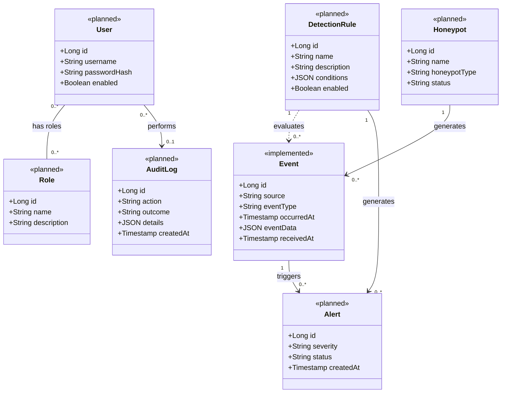

# HIVE Honeypot Network: Domain Class Diagram

## 1. Overview

 UML class diagram for the HIVE Honeypot Network. It describes the main domain classes, their attributes, relationships and multiplicities.
This diagram represents the specified domain design. Only the Event class is currently implemented; the remaining classes are planned.

## 2. UML Class Diagram

## 3. Class Responsibilities

| Class | Responsibility |
|---|---|
| User | Represents a person who accesses HIVE. An account can be disabled, preventing sign-in. |
| Role | Represents a set of permissions assigned to users, such as Admin or Analyst. Permissions are initially defined per role in application code. |
| Honeypot | Represents a controlled decoy service that generates security events. An administrator registers it and it receives a unique identifier. |
| Event | Represents a recorded activity submitted to HIVE, including its source, event type, timestamps and event data. |
| DetectionRule | Represents a condition for identifying suspicious activity. It can be enabled or disabled, and only enabled rules are evaluated. |
| Alert | Represents a notification generated when a detection rule matches an event. It references one rule and one event in the initial design. |
| AuditLog | Represents a record of a successful or failed security-relevant action. Audit records must never contain secrets. |

## 4. Relationships and Multiplicities

| Relationship | Multiplicity | Explanation |
|---|---|---|
| User – Role | Many-to-many | A user can have multiple roles, and a role can be assigned to multiple users. |
| User – AuditLog | One-to-many, optional user | A user can perform multiple recorded actions. An audit record may have zero or one associated user. |
| Honeypot – Event | One-to-many | A honeypot can generate multiple events. The association is planned. |
| DetectionRule – Event | Evaluation dependency | A detection rule evaluates events to identify suspicious activity. Evaluations are not stored as separate records. |
| DetectionRule – Alert | One-to-many | A detection rule can generate multiple alerts. |
| Event – Alert | One-to-many | An event can trigger multiple alerts. Each alert references exactly one event. |

## 5. Relationship and Database Design Notes

### 5.1 User and Role

The domain model represents User and Role as a many-to-many relationship.

In the relational database, this relationship is implemented through the `user_roles` junction table, which contains `user_id` and `role_id`.

Permissions are initially defined per role in application code. A separate permissions table is not included in the current design.

### 5.2 Honeypot and Event

A honeypot generates security events submitted to HIVE.

The intended association between Honeypot and Event is not yet enforced by a database foreign key. Currently, `events.source` is a text field intended to identify the registered honeypot.

Enforcing this relationship would require a migration adding a `honeypot_id` foreign key or an equivalent source-registration design.

### 5.3 DetectionRule and Event

Detection rules evaluate events, but the evaluation results are not stored as separate records.

Only events that match enabled rules produce alerts.

### 5.4 DetectionRule and Alert

Each alert references exactly one detection rule. A detection rule can generate multiple alerts.

### 5.5 Event and Alert

Each alert references exactly one event through `event_id`.

If the system later needs an alert to reference multiple events, an `alert_events` junction table can be introduced.

### 5.6 User and AuditLog

An audit record can reference a user through `user_id`.

Some actions may be system-generated or occur when the user cannot be identified, such as after a failed sign-in attempt.

## 6. Implementation Status

| Domain class | Status | Current situation |
|---|---|---|
| User | Planned | No users table or login flow exists. |
| Role | Planned | No roles table exists. |
| Honeypot | Planned | No honeypots table exists. |
| Event | Implemented | The PostgreSQL events table and backend event submission and retrieval exist. |
| DetectionRule | Planned | No detection_rules table exists. |
| Alert | Planned | No alerts table exists. |
| AuditLog | Planned | No audit_logs table exists. |

Only Event is currently implemented as a domain concept.

The Honeypot–Event association is planned because `events.source` is currently a plain text field.

The class diagram follows the current domain model and does not imply that planned classes or relationships have already been implemented.
