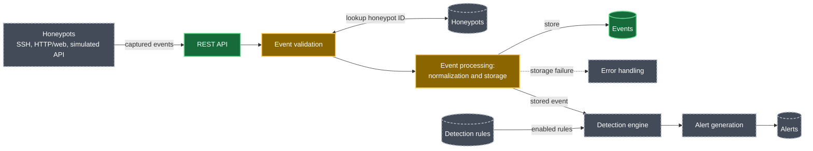
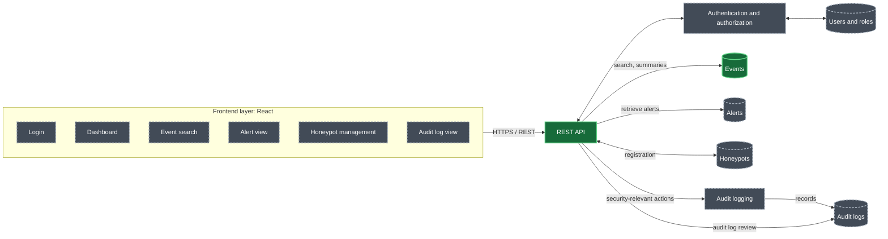
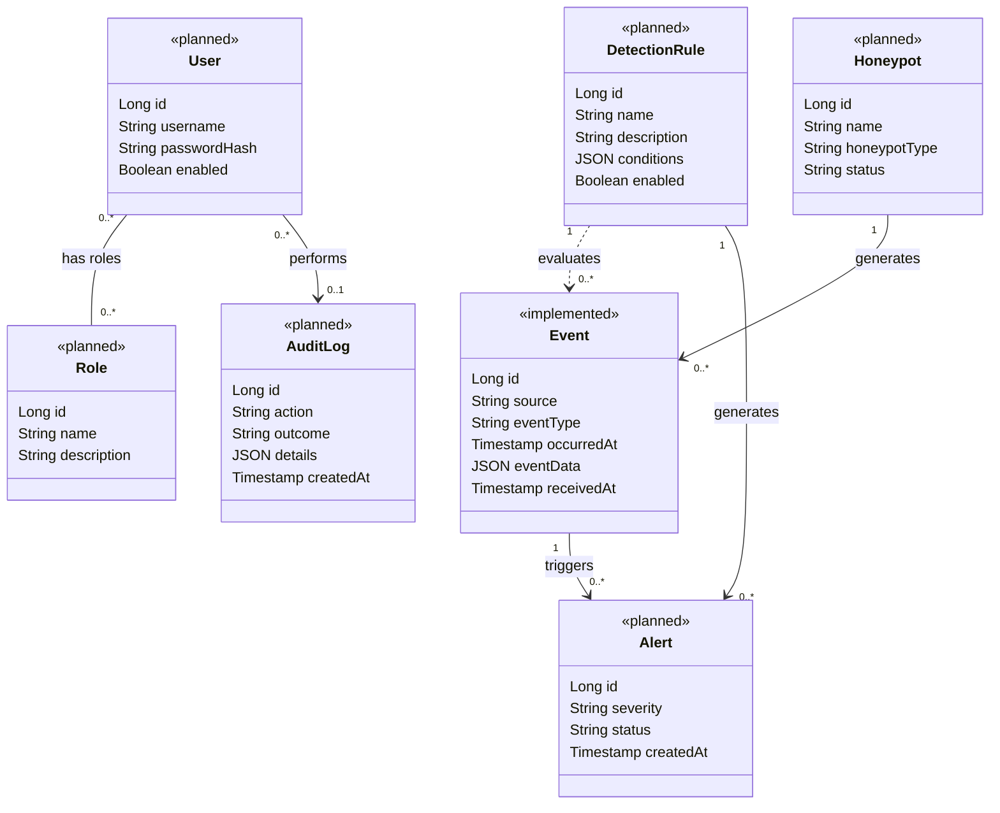
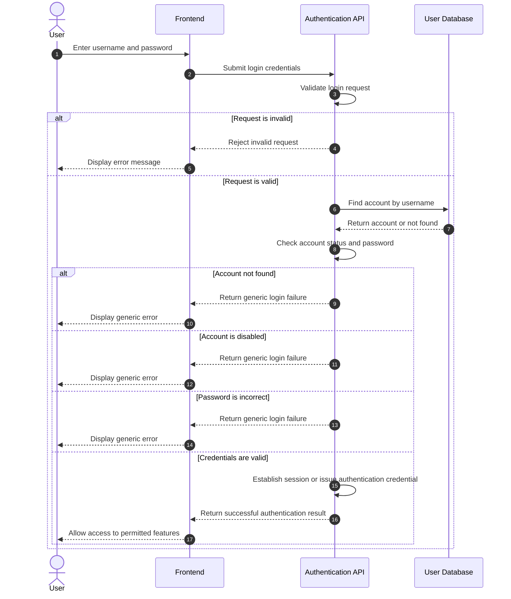
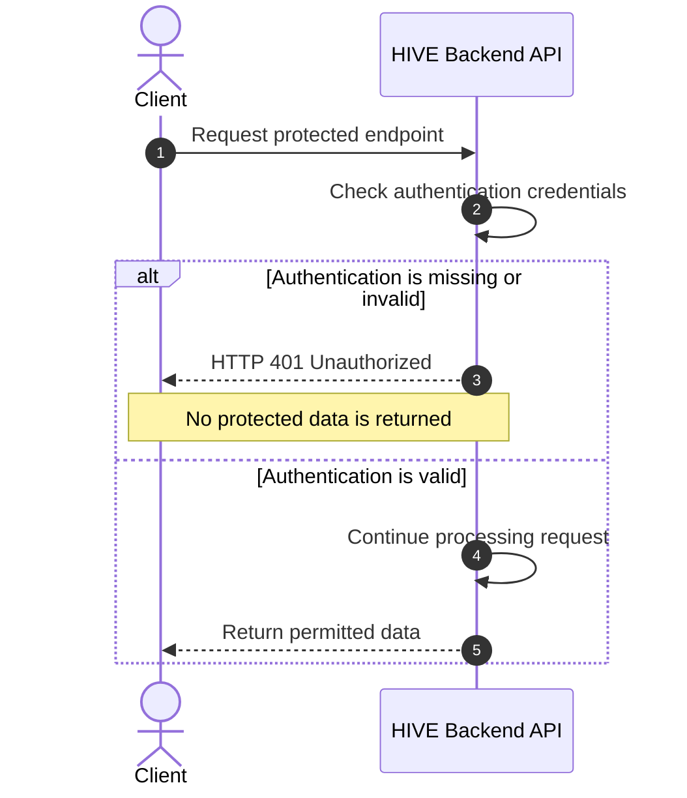
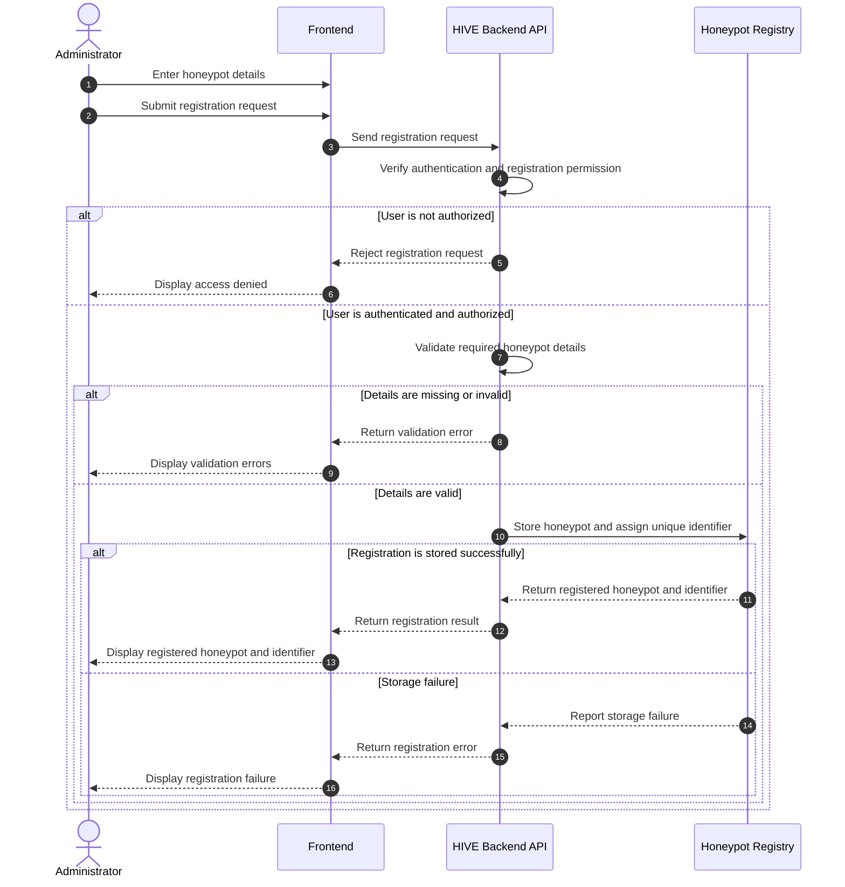
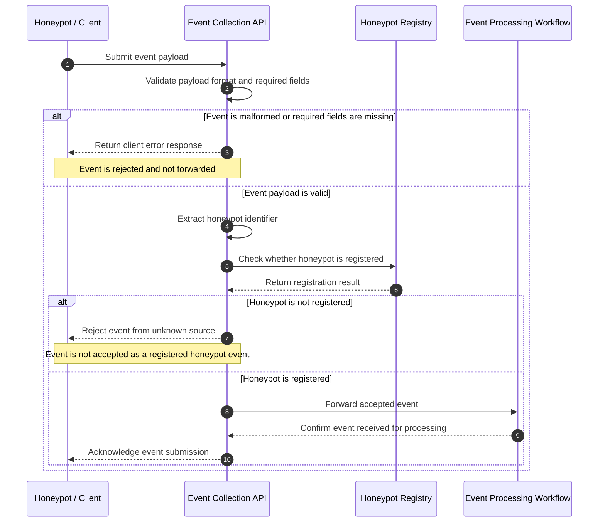
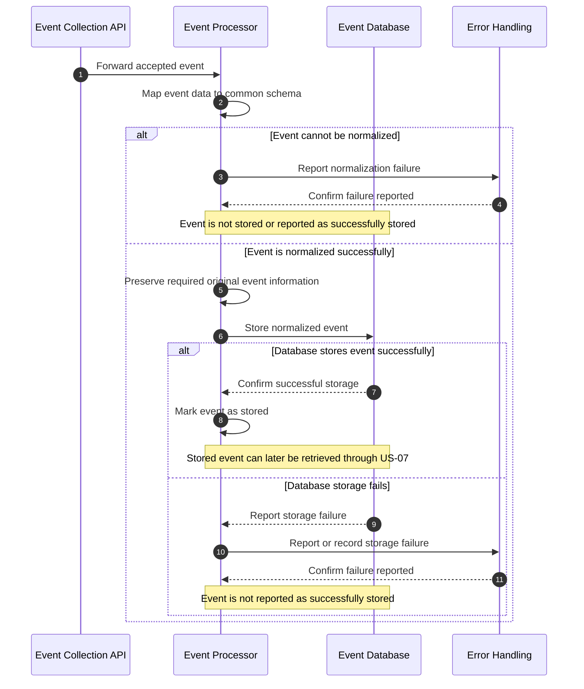
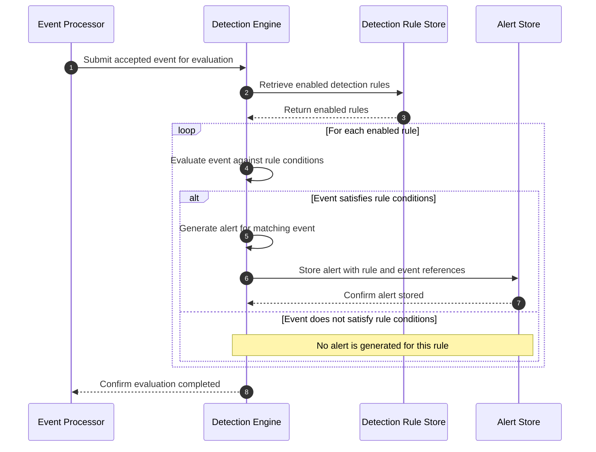
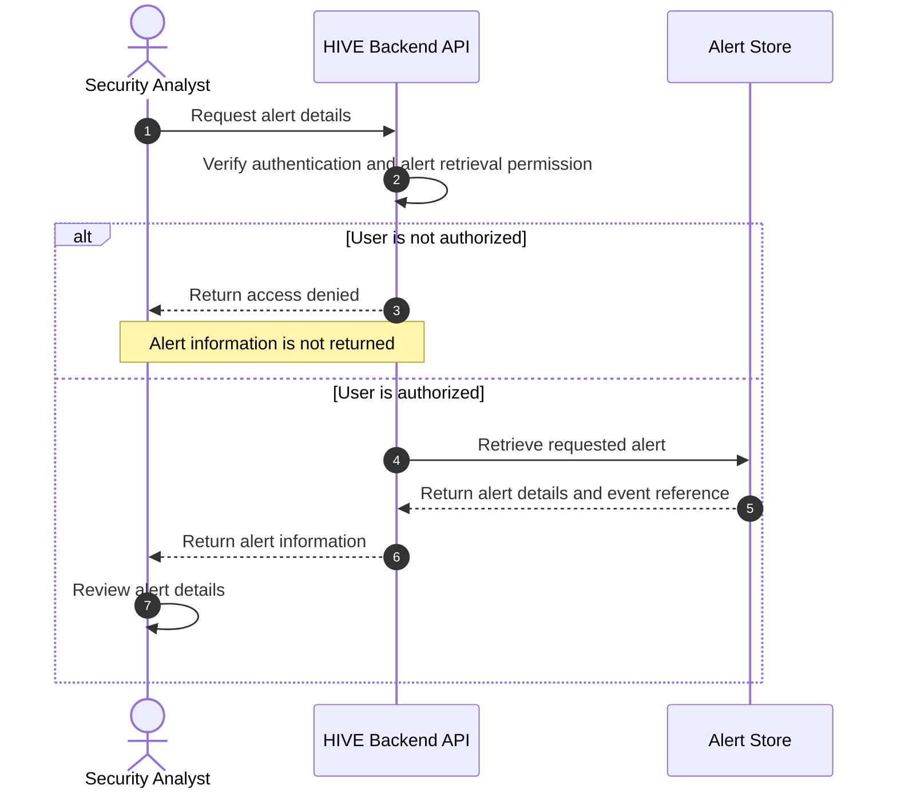

# HIVE Honeypot Network: Design Report

| | |
|---|---|
| **Project** | HIVE Honeypot Network |
| **Document** | Software Design Report |
| **Version** | 0.1 |
| **Date** | 15 November 2026 |
| **Architecture** | Go REST API, React frontend, PostgreSQL |
| **Repository** | `El-Dorado26/hive-honeypot-network` |

# 1. Introduction and Project Overview

## 1.1 Introduction

HIVE (Honeypot Intelligence and Visibility Environment) is a centralized honeypot monitoring and threat-analysis platform. Its purpose is to collect security events from different honeypots, process and store those events in a common format, and provide users with a centralized interface for reviewing security activity.

The project is designed to support the integration of different honeypot types, including SSH, HTTP/web, and a simulated API honeypot. By collecting their events through a common backend, HIVE aims to make security information easier to manage, search, and analyze.

## 1.2 Project Objectives

The main objectives of HIVE are:

- Collect security events from registered honeypots.
- Validate incoming events and reject malformed submissions or unknown sources.
- Normalize events into a common schema.
- Store event information in a centralized PostgreSQL database.
- Evaluate events against configurable detection rules.
- Generate and store alerts when suspicious activity is identified.
- Provide an interface for authorized users to review events and alerts.
- Support role-based access control and security audit logging.

## 1.3 System Scope

The initial system design covers:

- User authentication and role-based authorization.
- Honeypot registration.
- Event collection and validation.
- Event normalization and storage.
- Detection rules and alert generation.
- Dashboard and event search.
- Audit logging.

The internal implementation of individual honeypots and advanced features that are not covered by the initial user stories are outside the initial scope.

## 1.4 Design Approach

The design follows a layered architecture in which the frontend communicates with a centralized backend API, while the backend manages authentication, event processing, database operations, and other system services.

The design separates event collection from event processing. This allows incoming events to be validated before they enter the normalization and storage workflow.

The diagrams in this report represent the intended system design and distinguish between implemented, partially implemented, and planned components.

# 2. System Architecture

## 2.1 Architecture Overview

HIVE uses a client-server architecture with three main layers:

1. **Frontend layer:** Provides the user interface for authentication, event review, alert viewing, honeypot management, and audit-log review.
2. **Backend layer:** Provides REST API endpoints and handles authentication, authorization, event validation, processing, detection, and auditing.
3. **Database layer:** Stores users, roles, honeypots, events, detection rules, alerts, and audit logs.

The backend is responsible for enforcing security and business rules. The frontend provides the interface but is not trusted to enforce authorization independently.

## 2.2 Event Collection, Processing, and Detection Architecture

The following diagram illustrates the main event-processing workflow, from honeypot submissions to alert generation.

**Figure 1. Event collection, processing, and detection architecture.**

The workflow begins when a honeypot submits a captured event to the REST API. The API validates the event and checks whether its source corresponds to a registered honeypot.

Accepted events proceed to the event-processing workflow, where they are normalized into the common event schema and stored in PostgreSQL. Storage failures are handled separately so that HIVE does not report an event as successfully stored when persistence has failed.

After storage, events can be evaluated by the detection engine against enabled detection rules. When a rule matches an event, the system generates an alert and records it in the alert store.

The diagram distinguishes between the existing event API and database functionality, partially implemented validation and processing, and planned honeypot integration and detection components.

## 2.3 User Access, Administration, and Auditing

The following diagram illustrates how users interact with HIVE and how the backend handles access control, data retrieval, administration, and auditing.

**Figure 2. User access, administration, and auditing architecture.**

Users interact with HIVE through the React frontend. The frontend communicates with the backend REST API, which is responsible for authentication and authorization.

Authorized requests allow users to access the functions permitted by their assigned roles. These functions include event searching, alert retrieval, and honeypot administration.

Security-relevant actions are intended to be recorded through the audit-logging component. Audit records can subsequently be retrieved by authorized users.

HTTPS is shown as the intended communication protocol in the architecture. Its presence in the diagram represents the design target, not a claim that HTTPS deployment has already been completed.

## 2.4 Component Implementation Status

The architecture uses three status categories:

| Status | Meaning |
|---|---|
| Implemented | The component or behavior exists in the current system. |
| Partially implemented | Some functionality exists, but the complete required behavior is not implemented. |
| Planned | The component or behavior is defined in the design but has not yet been implemented. |

# 3. Domain Class Diagram

## 3.1 Overview

The domain class diagram describes the main entities within HIVE, their important attributes, and the relationships between them.

The model is based on the domain model and entity-relationship diagram in the Requirements Analysis Report.

The seven main domain classes are:

- User
- Role
- Honeypot
- Event
- DetectionRule
- Alert
- AuditLog

The Event class represents the currently implemented event entity. The remaining classes represent planned system functionality.

## 3.2 Domain Class Diagram

**Figure 3. HIVE domain class diagram.**

## 3.3 Class Responsibilities

| Class | Responsibility |
|---|---|
| User | Represents a person who accesses the HIVE platform. The account can be enabled or disabled. |
| Role | Represents a set of permissions assigned to users, such as Administrator or Analyst. |
| Honeypot | Represents a registered decoy service that generates security events. |
| Event | Represents an activity reported to HIVE, including its source, event type, timestamps, and event-specific data. |
| DetectionRule | Defines conditions used to identify suspicious activity. Rules can be enabled or disabled. |
| Alert | Represents a notification generated when a detection rule matches an event. |
| AuditLog | Records security-relevant actions and their outcomes. |

## 3.4 Relationships

- **User–Role:** A user can have multiple roles, and a role can be assigned to multiple users. The database represents this many-to-many relationship through the `user_roles` junction table.
- **User–AuditLog:** A user can be associated with multiple audit records. An audit record can optionally be associated with a user.
- **Honeypot–Event:** A honeypot can generate multiple events. Each event is intended to be associated with its originating honeypot.
- **DetectionRule–Event:** Detection rules evaluate events against their conditions. These evaluations are not represented as separately stored records in the initial model.
- **DetectionRule–Alert:** A detection rule can generate multiple alerts. Each alert references one detection rule.
- **Event–Alert:** An event can trigger multiple alerts. Each alert references one event in the initial database design.

## 3.5 Database Design Considerations

The class diagram represents the domain model, while the entity-relationship diagram defines how the entities are intended to be stored in PostgreSQL.

Important database design decisions include:

- User and role assignments are represented through the `user_roles` junction table.
- Role permissions are initially defined in application code rather than stored in a separate permissions table.
- Event-specific data is stored using JSONB to support different honeypot event formats.
- The current `events.source` field is text. A `honeypot_id` foreign key or equivalent registration mechanism is needed to enforce the honeypot relationship.
- Alerts reference one detection rule and one event in the initial design.
- An `alert_events` junction table may be introduced later if alerts need to reference multiple events.
- Audit records may have an optional reference to a user.

# 4. Sequence Diagrams

## 4.1 Overview

Sequence diagrams describe interactions between system components over time. They show the order in which messages are exchanged and how the system responds to successful and unsuccessful operations.

Five user stories are covered by sequence diagrams:

| User Story | Description | Coverage |
|---|---|---|
| US-01 | User Authentication | Covered |
| US-03 | Honeypot Registration | Covered |
| US-04 | Event Collection | Covered |
| US-05 | Event Normalization and Storage | Covered |
| US-06 | Detection Rules and Alerts | Covered |

This covers five out of eight user stories, giving a sequence-diagram coverage of 62.5%.

## 4.2 US-01: User Authentication

The authentication diagrams describe how a user submits credentials, how the backend verifies them, and how access to protected endpoints is handled.

### 4.2.1 User Login

**Figure 4. US-01 user login sequence diagram.**

The backend checks the submitted credentials and verifies that the account is enabled. Invalid credentials, unknown usernames, and disabled accounts result in a generic login failure. This avoids unnecessarily revealing whether a username exists.

The exact authentication mechanism remains a design decision. The requirements currently leave the choice between a session and an authentication credential open.

### 4.2.2 Access to a Protected Endpoint

**Figure 5. US-01 protected endpoint access sequence diagram.**

The backend must reject unauthenticated requests to protected endpoints and must not expose protected information.

## 4.3 US-03: Honeypot Registration

The honeypot registration sequence describes how an administrator submits a new honeypot, how the backend checks authorization and validates the details, and how the registered honeypot receives a unique identifier.

**Figure 6. US-03 honeypot registration sequence diagram.**

The backend performs authorization and validation before registering a honeypot. If either check fails, the registration is rejected. A successful registration stores the honeypot and returns its unique identifier.

The storage-failure branch represents an additional robustness case.

## 4.4 US-04: Event Collection

The event collection sequence describes how a registered honeypot submits an event and how HIVE validates the payload and verifies the event source before forwarding it for processing.

**Figure 7. US-04 event collection sequence diagram.**

The API first validates the event payload and then checks the honeypot identifier against the registry. Only events that pass both checks are forwarded to the event-processing workflow.

The acknowledgement indicates that the event has been accepted for processing, not necessarily that it has already been stored.

The exact mechanism for proving a honeypot's identity remains to be defined. A honeypot identifier alone should not be treated as proof of identity.

## 4.5 US-05: Event Normalization and Storage

The event normalization and storage sequence describes how an accepted event is mapped to the common event schema and persisted in the database.

**Figure 8. US-05 event normalization and storage sequence diagram.**

The Event Processor maps incoming event data to the common schema while preserving required information from the original event.

The normalized event is then stored in the database. HIVE must receive confirmation of successful persistence before reporting the event as stored.

Storage and normalization failures are handled separately. In either case, the event must not be reported as successfully stored.

## 4.6 US-06: Detection Rules and Alerts

Two sequence diagrams describe the detection and alert functionality: event evaluation and alert retrieval.

### 4.6.1 Event Evaluation and Alert Generation

**Figure 9. US-06 event evaluation and alert generation sequence diagram.**

The Detection Engine retrieves enabled rules and evaluates each rule against the accepted event. When the event satisfies a rule's conditions, an alert is generated and stored with references to the matching rule and event.

Disabled rules are excluded from evaluation. Non-matching events do not generate alerts for the corresponding rules.

### 4.6.2 Alert Retrieval

**Figure 10. US-06 alert retrieval sequence diagram.**

The backend checks whether the requesting user is authorized to retrieve alerts. If the user is not authorized, the request is denied and alert information is not returned.

For authorized users, the backend retrieves the requested alert and returns its defined details, including its associated event reference.

The retrieval authorization mechanism is part of the role-based authorization functionality described in US-02.

## 4.7 Sequence Diagram Coverage

The five selected user stories cover the main interactions in HIVE, from authentication and honeypot registration to event collection, processing, and alert generation.

| User Story | Number of diagrams | Main functionality |
|---|---:|---|
| US-01 | 2 | Login and protected endpoint access |
| US-03 | 1 | Honeypot registration |
| US-04 | 1 | Event submission and validation |
| US-05 | 1 | Event normalization and storage |
| US-06 | 2 | Alert generation and retrieval |
| **Total** | **7** | **5 of 8 user stories** |

# 5. Design Decisions Related to Non-Functional Requirements

## 5.1 Overview

Non-functional requirements describe quality attributes and constraints that influence how the system is designed and implemented.

The HIVE design considers security, data integrity, reliability, flexibility, data quality, and extensibility.

The following table summarizes the six non-functional requirements defined in the Requirements Analysis Report.

| ID | Category | Requirement | Status |
|---|---|---|---|
| NFR-01 | Security | The system shall store user passwords only as hashes. | Specified |
| NFR-02 | Data integrity | Every entity shall have a unique identifier, and relationships between tables shall be enforced by PostgreSQL foreign keys once the tables exist. | Partially implemented |
| NFR-03 | Reliability | The system shall never report an event as stored unless it has been persisted. | Specified |
| NFR-04 | Flexibility | Event-specific details shall be stored as JSONB so that events from different honeypot types fit one common schema. | Implemented |
| NFR-05 | Data quality | Event times (`occurred_at`, `received_at`) shall be stored with time zone information. | Implemented |
| NFR-06 | Extensibility | The design shall allow later additions without redesign: a `honeypot_id` foreign key on events, an `alert_events` junction table, and a permissions table. | Specified |

## 5.2 NFR-01: Password Security

**Requirement:** User passwords must be stored only as hashes.

**Design decision:** Passwords must not be stored in plaintext. The authentication design uses a password-hashing approach so that the original password is not directly stored in the database.

The domain model includes a `passwordHash` attribute for the User entity rather than a plaintext password attribute.

**Security benefit:** If the user database is exposed, password hashes do not directly reveal the original passwords. Password hashing helps reduce the impact of a database compromise.

**Status:** Specified. The complete user-management and authentication implementation remains planned.

## 5.3 NFR-02: Data Integrity

**Requirement:** Every entity must have a unique identifier, and relationships between database tables must be enforced using PostgreSQL foreign keys once the tables exist.

**Design decision:** The database design uses entity identifiers and foreign-key relationships to maintain consistency between related records.

Examples include:

- User-role assignments through `user_roles`.
- Alerts referencing detection rules and events.
- Audit logs optionally referencing users.
- Honeypot records associated with their generated events.

The current event table has an identifier, but the complete set of entities and relationships has not yet been implemented.

**Benefit:** Unique identifiers and foreign-key constraints help prevent invalid references and maintain consistency across related records.

**Status:** Partially implemented.

## 5.4 NFR-03: Reliability

**Requirement:** HIVE must never report an event as stored unless it has actually been persisted.

**Design decision:** The event-processing workflow waits for confirmation from the database before reporting successful storage.

If a database operation fails, the processing workflow reports or records the failure through the error-handling mechanism. The event must not be marked as successfully stored.

**Reliability benefit:** This prevents the system from falsely reporting successful event persistence and helps maintain accurate information about collected security events.

**Status:** Specified. The complete failure-handling behavior remains to be implemented and verified.

## 5.5 NFR-04: Flexible Event Storage

**Requirement:** Event-specific details must be stored as JSONB so that events from different honeypot types can fit into a common schema.

**Design decision:** PostgreSQL JSONB is used for the `event_data` field in the events table.

This allows event-specific information to vary without requiring a separate database table for every honeypot type.

The common event structure maintains shared information such as the source, event type, event timestamps, and event-specific data.

**Flexibility benefit:** New event types can be introduced while retaining a consistent storage structure.

**Status:** Implemented.

## 5.6 NFR-05: Timezone-Aware Event Timestamps

**Requirement:** Event timestamps (`occurred_at` and `received_at`) must store time zone information.

**Design decision:** PostgreSQL timezone-aware timestamp fields are used for event occurrence and receipt times.

The two timestamps represent different events:

- `occurred_at`: When the activity originally happened at the honeypot.
- `received_at`: When HIVE received the event.

**Data-quality benefit:** Keeping both timestamps makes it possible to distinguish the time of the original activity from the time the event reached HIVE.

**Status:** Implemented.

## 5.7 NFR-06: Extensibility

**Requirement:** The design must support future additions without requiring a complete redesign.

**Design decision:** The database design identifies several possible extensions:

- A `honeypot_id` foreign key on the events table to enforce the relationship between registered honeypots and their events.
- An `alert_events` junction table if an alert needs to reference multiple events.
- A permissions table if permissions need to be managed through the database rather than application code.

These extensions are not part of the currently implemented database structure. They are documented as possible future design changes.

**Extensibility benefit:** The system can evolve to support more complex honeypot relationships, alert associations, and permission management.

**Status:** Specified.

## 5.8 Additional Quality Considerations

Some quality targets remain open and need to be defined before the system can be evaluated fully.

These include:

- API response-time targets.
- Maximum expected event ingestion rate.
- System availability expectations.
- Event retention and deletion policies.
- Audit-log retention requirements.
- Recovery behavior following database or service failures.

# 6. Tools and Technologies Used

The following tools and technologies form the basis of the HIVE design and development work.

| Tool / Technology | Purpose |
|---|---|
| Go | Backend API and event-processing implementation. |
| PostgreSQL | Relational database for storing events and planned system entities. |
| JSONB | Flexible storage for event-specific data. |
| React | Planned frontend interface for user interaction and monitoring. |
| Mermaid | Architecture, class, and sequence diagrams maintained as Markdown source. |
| Git | Version control and change tracking. |
| GitHub | Source-code hosting, documentation management, branches, and pull requests. |
| Markdown | Project documentation and design reports. |

# 7. Conclusion

This report presents the architectural and design structure of the HIVE Honeypot Network.

The architecture separates frontend interaction, backend processing, and database storage. It provides a workflow for collecting events from registered honeypots, validating incoming data, normalizing accepted events, and storing them in a common format.

The domain class diagram identifies the main entities and their relationships, while the sequence diagrams describe the interactions required for authentication, honeypot registration, event collection, event processing, and alert management.

The design also considers important non-functional requirements, including password security, data integrity, reliability, flexible event storage, timestamp accuracy, and future extensibility.

Although some functionality has already been implemented, several components remain planned. The implementation-status distinctions in this report make that separation explicit.

Overall, the design provides a structured foundation for continuing HIVE development while keeping the system's architecture, requirements, and implementation aligned.

---
