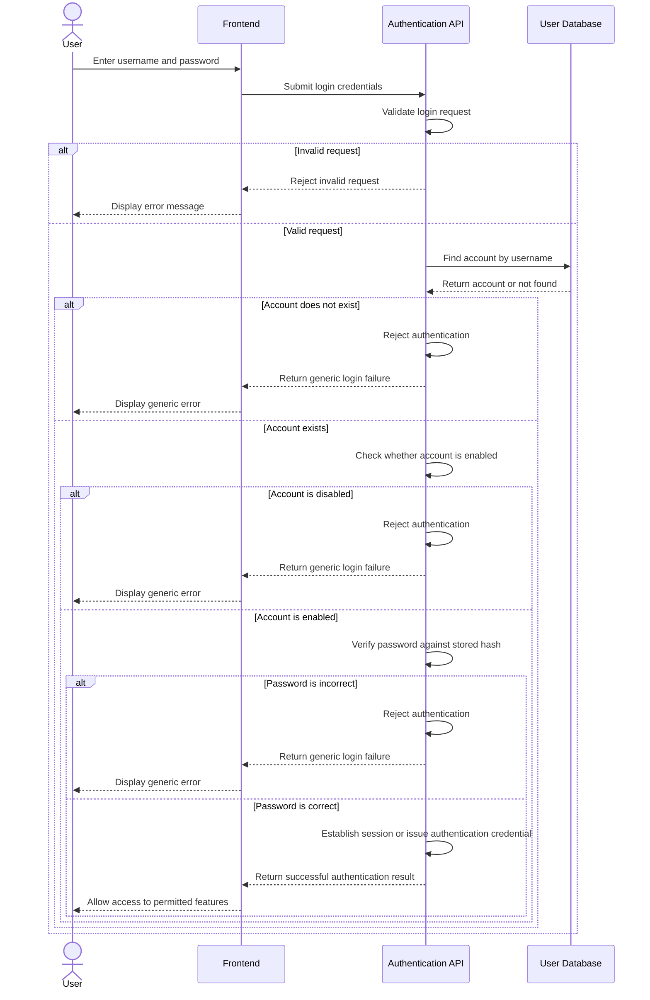
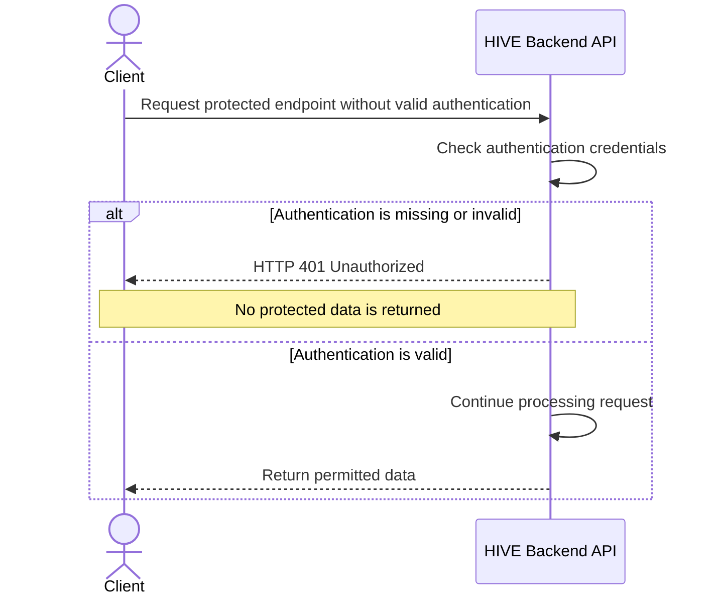

# US-01: User Authentication: Sequence Diagrams

## 1. Purpose

These sequence diagrams describe how HIVE authenticates users, rejects invalid login attempts, and denies unauthenticated access to protected API endpoints.

**Primary actor:** Registered user  
**Supporting components:** Frontend, HIVE backend, user database

**Source:** `docs/analysis/behavior/US-01-authentication-bpd.md`

## 2. Sequence Diagram 1: User Login

This diagram covers successful authentication, invalid credentials, unknown usernames, and disabled accounts.

## 3. Sequence Diagram 2: Access to a Protected Endpoint

This diagram covers the unauthenticated API request scenario. It shows that the backend must reject a request when the client does not present valid authentication.

## 4. Acceptance Criteria Mapping

| US-01 Scenario | Description | Sequence Diagram |
|---|---|---|
| Scenario 1 | Successful login with valid credentials | Diagram 1 |
| Scenario 2 | Invalid credentials, including an unknown username or incorrect password | Diagram 1 |
| Scenario 3 | Unauthenticated request to a protected API endpoint | Diagram 2 |
| Scenario 4 | Disabled account cannot authenticate | Diagram 1 |

The diagrams are based on the US-01 behavioral model and its acceptance scenarios.
