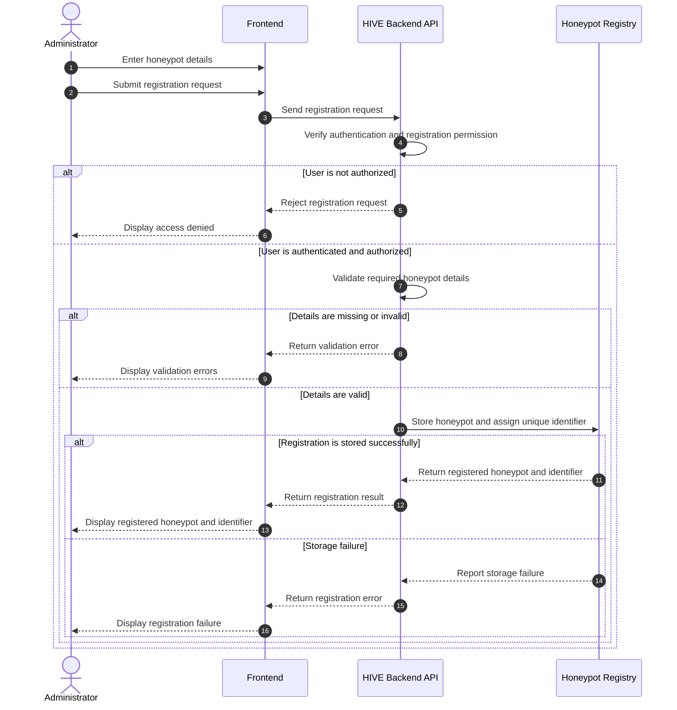

# US-03: Honeypot Registration: Sequence Diagram

## 1. Purpose

This sequence diagram describes how an administrator registers a honeypot in HIVE. It covers successful registration, rejection of invalid registration details, and denial of users who do not have permission to manage honeypots.

**Primary actor:** Administrator  
**Supporting components:** Frontend, HIVE backend, honeypot registry

**Source:** `docs/analysis/behavior/US-03-honeypot-registration-bpd.md`

## 2. Sequence Diagram: Honeypot Registration

This diagram covers all three US-03 acceptance scenarios. The backend checks authentication and authorization before validating the submitted details. A honeypot is stored and assigned a unique identifier only after the authorization and validation checks succeed.

## 3. Acceptance Criteria Mapping

| US-03 Scenario | Description | Sequence Diagram | Branch |
|---|---|---|---|
| Scenario 1 | Administrator successfully registers a honeypot | Diagram 1 | User authorized → Details valid → Registration stored successfully |
| Scenario 2 | Invalid registration details are rejected | Diagram 1 | Details are missing or invalid |
| Scenario 3 | User without permission cannot register a honeypot | Diagram 1 | User is not authorized |

The storage-failure branch is an additional robustness case. It is not required by the US-03 acceptance criteria.

## 4. Design Notes

- The backend is responsible for checking authentication and authorization; the frontend must not be trusted to enforce permissions by itself.
- Honeypot details must pass backend validation before they are stored.
- The unique identifier is assigned during registration and returned to the frontend.
- If authorization or validation fails, no honeypot is registered.
- If storage fails, the backend must not report the honeypot as successfully registered.
- The exact HTTP response codes and honeypot identity-verification mechanism remain subject to the project's design decisions.

The diagram is based on the US-03 behavioral model and its three acceptance scenarios.
