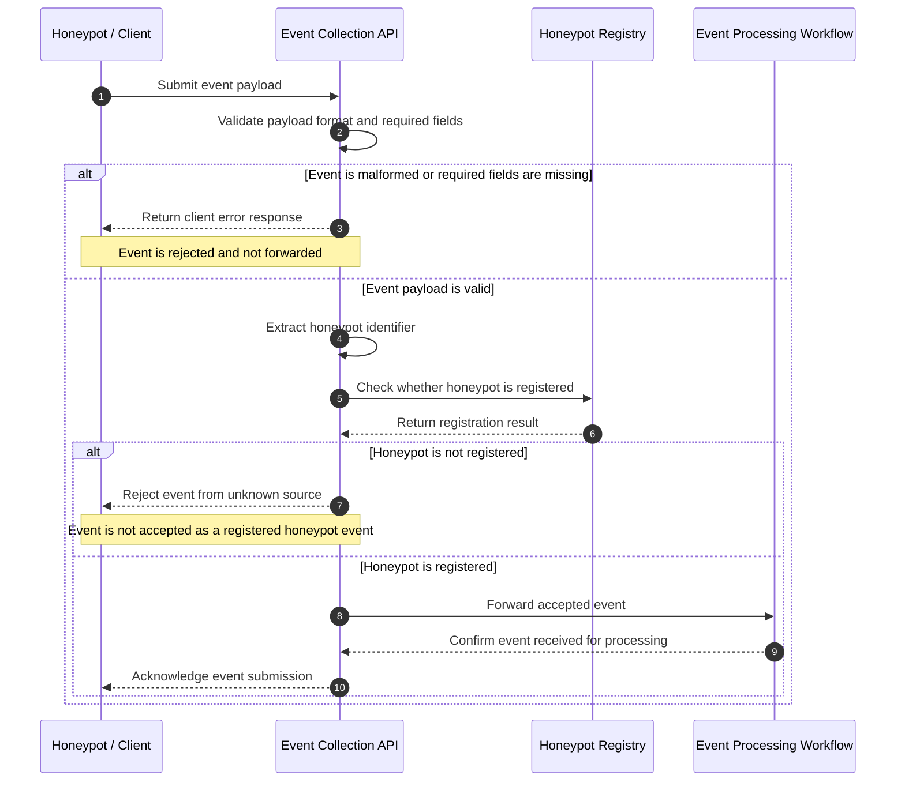

# US-04: Event Collection: Sequence Diagram

## 1. Purpose

This sequence diagram describes how HIVE receives security events from registered honeypots, validates incoming event payloads, verifies the submitting honeypot, and forwards accepted events to the event-processing workflow.

**Primary actor:** Registered honeypot  
**Supporting components:** HIVE Event Collection API, Honeypot Registry, Event Processing Workflow

**Source:** `docs/analysis/behavior/US-04-event-collection-bpd.md`

## 2. Sequence Diagram: Event Submission

This diagram covers all three US-04 acceptance scenarios: accepting a valid event, rejecting a malformed event, and rejecting an event from an unknown source.

## 3. Acceptance Criteria Mapping

| US-04 Scenario | Description | Sequence Diagram | Branch |
|---|---|---|---|
| Scenario 1 | Accept a valid event from a registered honeypot | Diagram 1 | Event payload is valid → Honeypot is registered |
| Scenario 2 | Reject a malformed event | Diagram 1 | Event is malformed or required fields are missing |
| Scenario 3 | Reject an event from an unknown source | Diagram 1 | Honeypot is not registered |

## 4. Design Notes

- The Event Collection API validates the event payload before checking its source.
- The Honeypot Registry is consulted to verify that the submitting honeypot is registered.
- Events from unknown sources must not be accepted as events from registered honeypots.
- Only events that pass both validation and source verification are forwarded to the event-processing workflow.
- The acknowledgement indicates that the event was accepted for processing; it does not necessarily mean that normalization and database storage have completed.
- The exact source-authentication mechanism is not yet specified. A honeypot identifier alone should not be treated as proof of identity.

The diagram is based on the US-04 behavioral model and its three acceptance scenarios.
