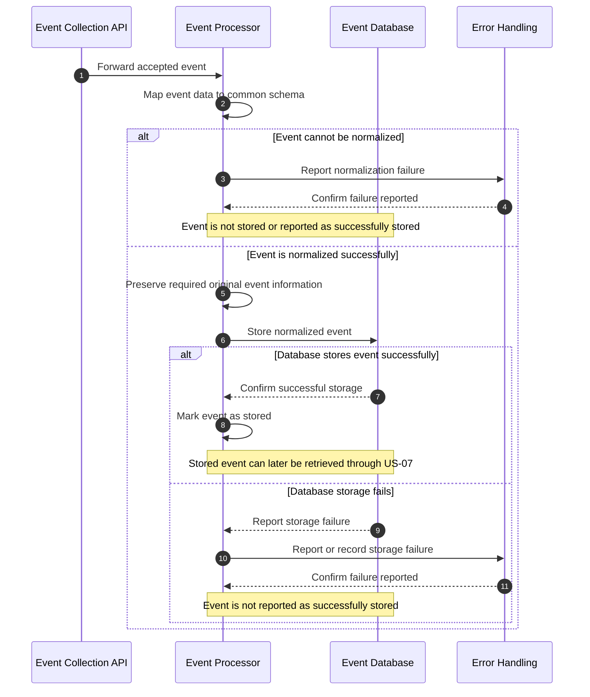

# US-05: Event Normalization and Storage: Sequence Diagram

## 1. Purpose

This sequence diagram describes how HIVE processes an accepted event, maps its data to a common event schema, preserves the required information, and stores the normalized event in the database.

It also covers storage failures and an additional normalization-failure case.

**Primary actor:** HIVE Event Processing Workflow  
**Supporting components:** Event Collection API, Event Processor, Event Database, Error Handling

**Source:** `docs/analysis/behavior/US-05-event-storage-bpd.md`

## 2. Sequence Diagram: Event Normalization and Storage

This diagram covers the three US-05 acceptance scenarios: normalizing an accepted event, storing the normalized event, and handling a storage failure.

## 3. Acceptance Criteria Mapping

| US-05 Scenario | Description | Sequence Diagram | Branch |
|---|---|---|---|
| Scenario 1 | Normalize an accepted event into the common event schema | Diagram 1 | Event is normalized successfully |
| Scenario 2 | Store a normalized event in the database | Diagram 1 | Database stores event successfully |
| Scenario 3 | Handle a database storage failure | Diagram 1 | Database storage fails |

The normalization-failure branch is an additional robustness case. It is not required by the US-05 acceptance criteria.

## 4. Design Notes

- The diagram begins after the Event Collection API has accepted an event through US-04.
- The Event Processor maps incoming event data to the common event schema.
- Required information from the original event must be preserved during normalization.
- The normalized event is stored in the Event Database.
- A successful database response is required before HIVE reports the event as stored.
- Storage and normalization failures must be reported or recorded through the error-handling mechanism.
- Event retrieval and search are covered separately by US-07; this diagram does not implement or specify the search mechanism.

The diagram is based on the US-05 behavioral model and its three acceptance scenarios.
