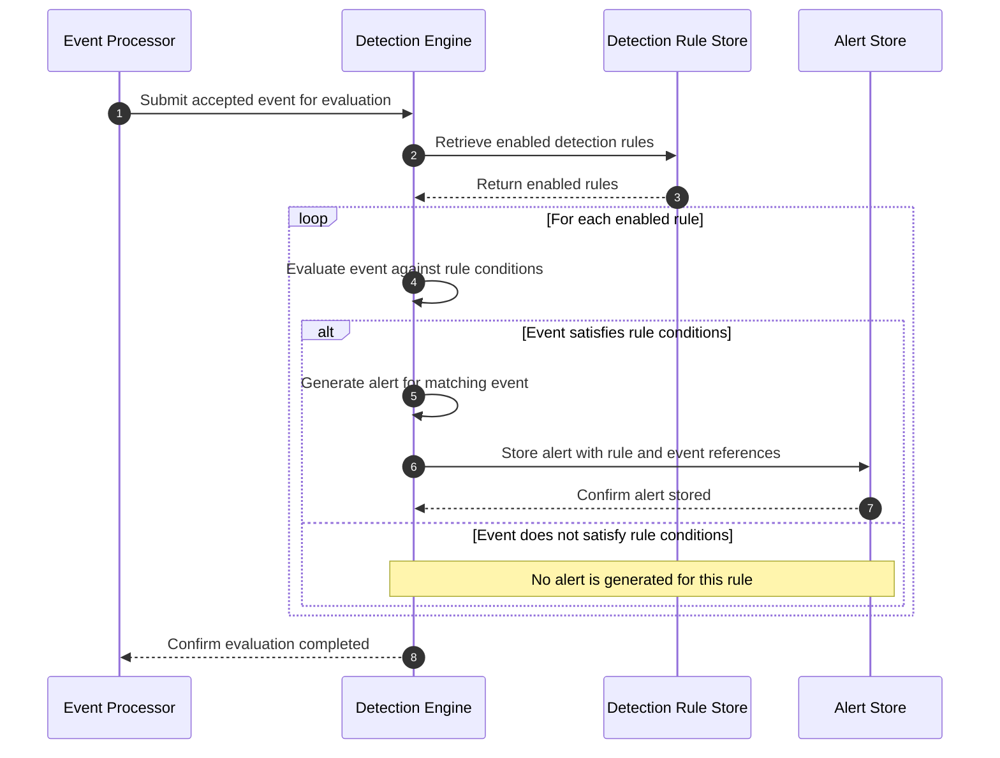
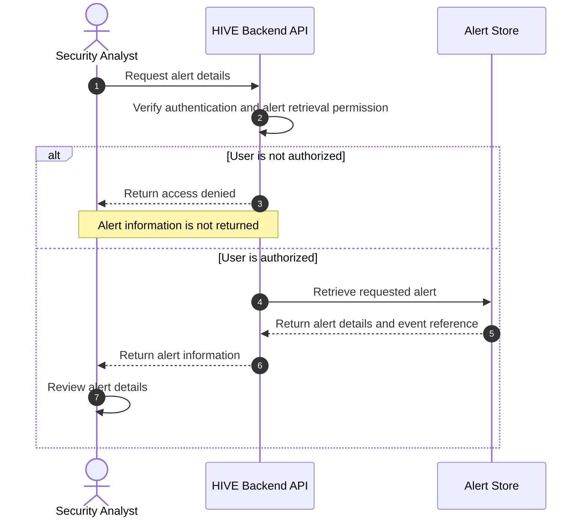

# US-06: Detection Rules and Alerts: Sequence Diagrams

## 1. Purpose

These sequence diagrams describe how HIVE evaluates accepted events against enabled detection rules, generates and stores alerts for matching events, and allows authorized analysts to retrieve alert information.

**Primary actor:** Security Analyst  
**Supporting components:** Event Processor, Detection Engine, Detection Rule Store, Alert Store, HIVE Backend API

**Source:** `docs/analysis/behavior/US-06-detection-alerts-bpd.md`

## 2. Sequence Diagram 1: Event Evaluation and Alert Generation

This diagram covers the evaluation of accepted events against enabled detection rules. An alert is generated and stored when an event satisfies a rule's conditions. Disabled rules are excluded from evaluation, and non-matching events do not generate alerts.

## 3. Sequence Diagram 2: Alert Retrieval

This diagram covers the analyst's request to retrieve alert information. The backend checks authorization before accessing and returning the requested alert details.

## 4. Acceptance Criteria Mapping

| US-06 Scenario | Description | Sequence Diagram | Branch |
|---|---|---|---|
| Scenario 1 | Generate an alert when an event matches a detection rule | Diagram 1 | Event satisfies rule conditions |
| Scenario 2 | Do not generate an alert when an event does not match a detection rule | Diagram 1 | Event does not satisfy rule conditions |
| Scenario 3 | Preserve alert information and make it retrievable | Diagram 2 | User is authorized → Alert details retrieved |

Disabled rules are excluded when the Detection Engine retrieves enabled rules in Diagram 1. Therefore, disabled rules are not evaluated and cannot generate alerts.

## 5. Design Notes

- The Detection Engine receives accepted events from the event-processing workflow after US-04 and US-05.
- Only enabled detection rules are retrieved for evaluation.
- Each enabled rule is evaluated independently against the event.
- An alert is generated only when the event satisfies a rule's conditions.
- Each generated alert is associated with its matching detection rule and event.
- Alert details are stored in the Alert Store.
- The backend verifies authorization before returning alert information to an analyst. Role-based authorization is defined separately in US-02.

The diagrams are based on the US-06 behavioral model and its three acceptance scenarios.
