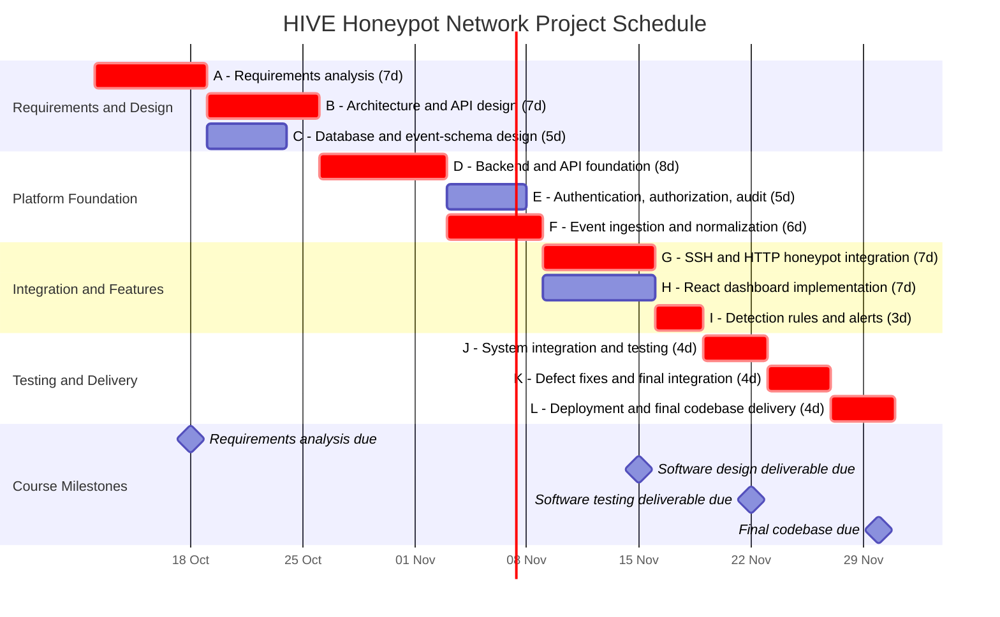

# HIVE Gantt Chart and Project Schedule

## 1. Purpose

This Gantt chart translates the HIVE PERT dependency network into calendar dates. Task IDs, durations, and dependencies correspond to `docs/PERT.md`.

The project schedule runs from 12 October through 30 November 2026. The final codebase deadline is 30 November 2026 at 23:59.

## 2. Gantt Chart

## 3. Schedule Summary

| Activity | Planned Start | Planned Finish |
|---|---|---|
| A - Requirements analysis | 12 Oct | 18 Oct |
| B - Architecture and API design | 19 Oct | 25 Oct |
| C - Database and event-schema design | 19 Oct | 23 Oct |
| D - Backend and API foundation | 26 Oct | 2 Nov |
| E - Authentication, authorization, audit | 3 Nov | 7 Nov |
| F - Event ingestion and normalization | 3 Nov | 8 Nov |
| G - SSH and HTTP honeypot integration | 9 Nov | 15 Nov |
| H - React dashboard implementation | 9 Nov | 15 Nov |
| I - Detection rules and alerts | 16 Nov | 18 Nov |
| J - System integration and testing | 19 Nov | 22 Nov |
| K - Defect fixes and final integration | 23 Nov | 26 Nov |
| L - Deployment and final codebase delivery | 27 Nov | 30 Nov |

## 4. Critical Path

The critical-path activities are marked with `crit` in the Mermaid chart:

**A → B → D → F → G → I → J → K → L**

The planned duration is 50 calendar days, ending at the 30 November deadline.

Tasks C, E, and H are not marked as critical in this baseline schedule. Their slack values are documented in `docs/PERT.md`.

## 5. Milestone Management

- **18 October:** Requirements analysis must be completed and submitted.
- **15 November:** The software design deliverable must be completed and submitted.
- **22 November:** The software testing deliverable must be completed and submitted.
- **30 November:** The final codebase must be delivered by 23:59.

The team should review progress at each milestone. If a critical-path task falls behind, the project manager should revise the schedule, re-evaluate dependencies, and identify recovery actions.

## 6. Scheduling Assumptions

1. All task durations are estimated in calendar days, not working days.
2. Tasks may overlap only where the dependency network permits it.
3. Task dates are derived from the dependency chain and the stated durations.
4. The course milestones are fixed deadlines.
5. Optional advanced features are outside the required critical path and must not delay final delivery.
6. The schedule must be recalculated if the task estimates or dependencies change.
