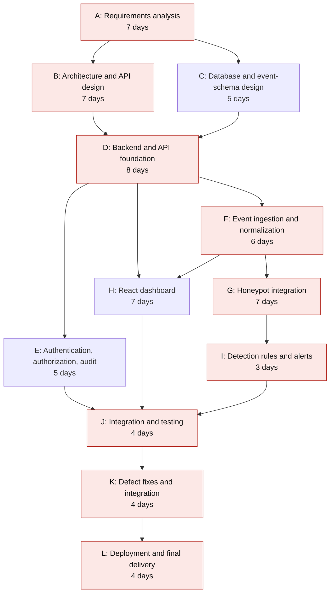

# HIVE PERT Network and Critical Path Analysis

## 1. Purpose

This document defines the activity dependencies, estimated durations, earliest and latest schedule times, slack, and critical path for the HIVE Honeypot Network project.

All durations are estimated in calendar days. Day 0 is 12 October 2026. The final codebase deadline is 30 November 2026 at 23:59.

These estimates are planning assumptions and will be updated if team capacity, implementation scope, or dependencies change.

## 2. Activity and Dependency Table

| ID | Activity | Duration (days) | Predecessor(s) |
|---|---|---:|---|
| A | Requirements analysis and traceability | 7 | None |
| B | Architecture and API design | 7 | A |
| C | Database and event-schema design | 5 | A |
| D | Backend and API foundation | 8 | B, C |
| E | Authentication, authorization, and audit logging | 5 | D |
| F | Event ingestion and normalization | 6 | D |
| G | SSH and HTTP honeypot integration | 7 | F |
| H | React dashboard implementation | 7 | D, F |
| I | Detection rules and alerts | 3 | G |
| J | System integration and testing deliverable | 4 | E, H, I |
| K | Defect fixes and final integration | 4 | J |
| L | Deployment verification and final codebase delivery | 4 | K |

## 3. Dependency Network

## 4. CPM Schedule Calculations

ES = Earliest Start  
EF = Earliest Finish  
LS = Latest Start  
LF = Latest Finish  
Slack = LS - ES

The schedule uses a zero-based time scale. An activity with ES = 0 starts on 12 October. Its finish time is the boundary at which the next activity may start.

| ID | Duration | ES | EF | LS | LF | Slack |
|---|---:|---:|---:|---:|---:|---:|
| A | 7 | 0 | 7 | 0 | 7 | 0 |
| B | 7 | 7 | 14 | 7 | 14 | 0 |
| C | 5 | 7 | 12 | 9 | 14 | 2 |
| D | 8 | 14 | 22 | 14 | 22 | 0 |
| E | 5 | 22 | 27 | 33 | 38 | 11 |
| F | 6 | 22 | 28 | 22 | 28 | 0 |
| G | 7 | 28 | 35 | 28 | 35 | 0 |
| H | 7 | 28 | 35 | 31 | 38 | 3 |
| I | 3 | 35 | 38 | 35 | 38 | 0 |
| J | 4 | 38 | 42 | 38 | 42 | 0 |
| K | 4 | 42 | 46 | 42 | 46 | 0 |
| L | 4 | 46 | 50 | 46 | 50 | 0 |

## 5. Critical Path

The critical path is:

**A → B → D → F → G → I → J → K → L**

Total duration:

7 + 7 + 8 + 6 + 7 + 3 + 4 + 4 + 4 = **50 calendar days**

With the assumed start date of 12 October 2026, the plan reaches the final delivery boundary on 1 December 2026 at 00:00, equivalent to the end of 30 November.

Activities on the critical path have zero slack. A delay to one of these activities will delay the planned completion unless time is recovered elsewhere.

## 6. Activities with Slack

- **C: Database and event-schema design:** 2 days of slack.
- **H: React dashboard implementation:** 3 days of slack.
- **E: Authentication, authorization, and audit logging:** 11 days of slack under these dependencies.

Slack is the amount an activity can be delayed without changing the planned project completion, assuming all other durations and dependencies remain unchanged.

## 7. Milestones

| Milestone | Deadline |
|---|---|
| Requirements analysis completed | 18 October 2026 |
| Software design deliverable | 15 November 2026 |
| Software testing deliverable | 22 November 2026 |
| Final codebase delivered | 30 November 2026, 23:59 |

The milestone dates are course deadlines, not extra activity durations. The team must complete the corresponding documentation and submission work by each deadline.

## 8. Assumptions and Risks

1. The plan assumes that the team can work on parallel activities where dependencies allow.
2. The plan assumes that the required SSH and HTTP integrations can be completed within the estimated duration.
3. Optional advanced features are excluded from the critical path.
4. The testing deliverable is due on 22 November. Subsequent defect fixes must not be used to claim that the testing deadline was met if the required test report was not submitted by that date.
5. The project manager should update the estimates and recalculate slack and the critical path whenever task durations or dependencies change.
