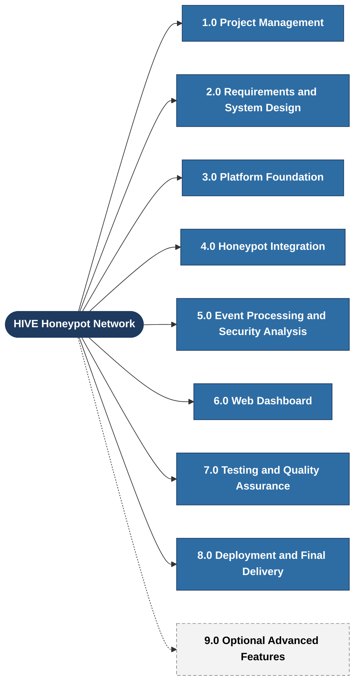
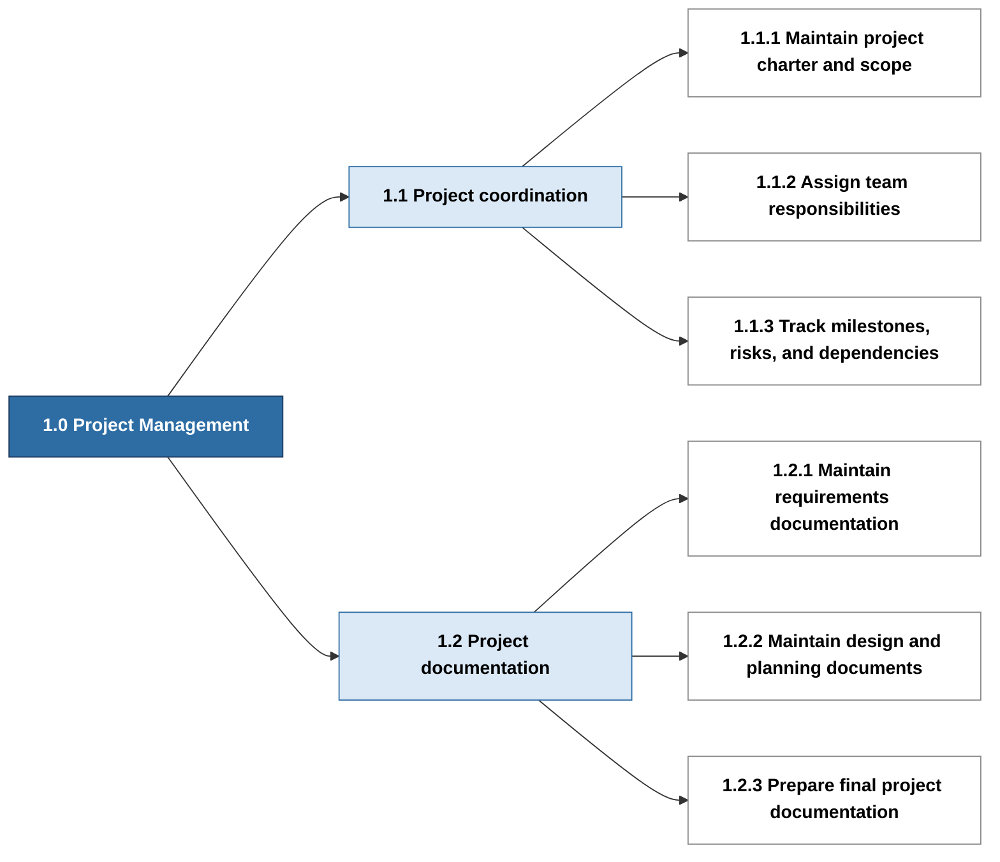
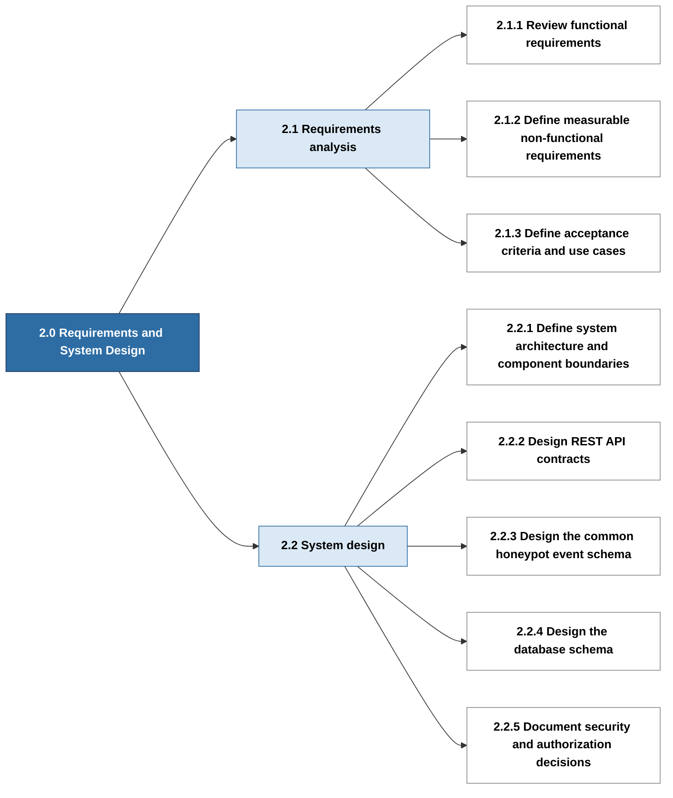
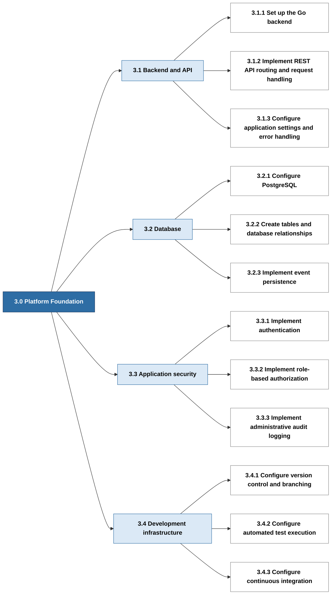
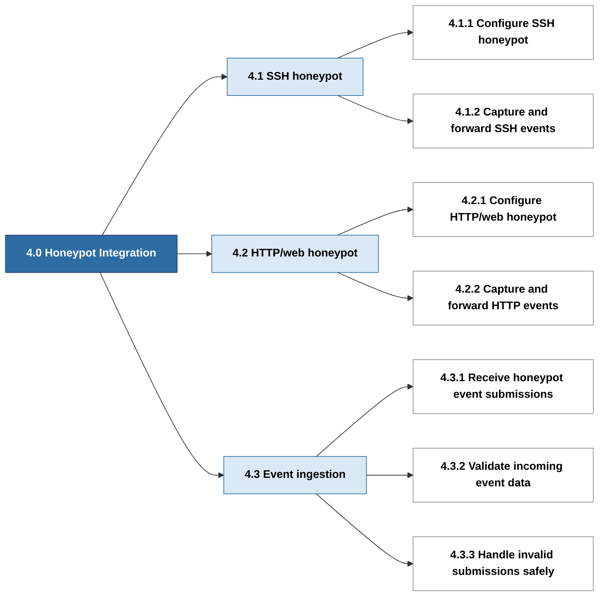
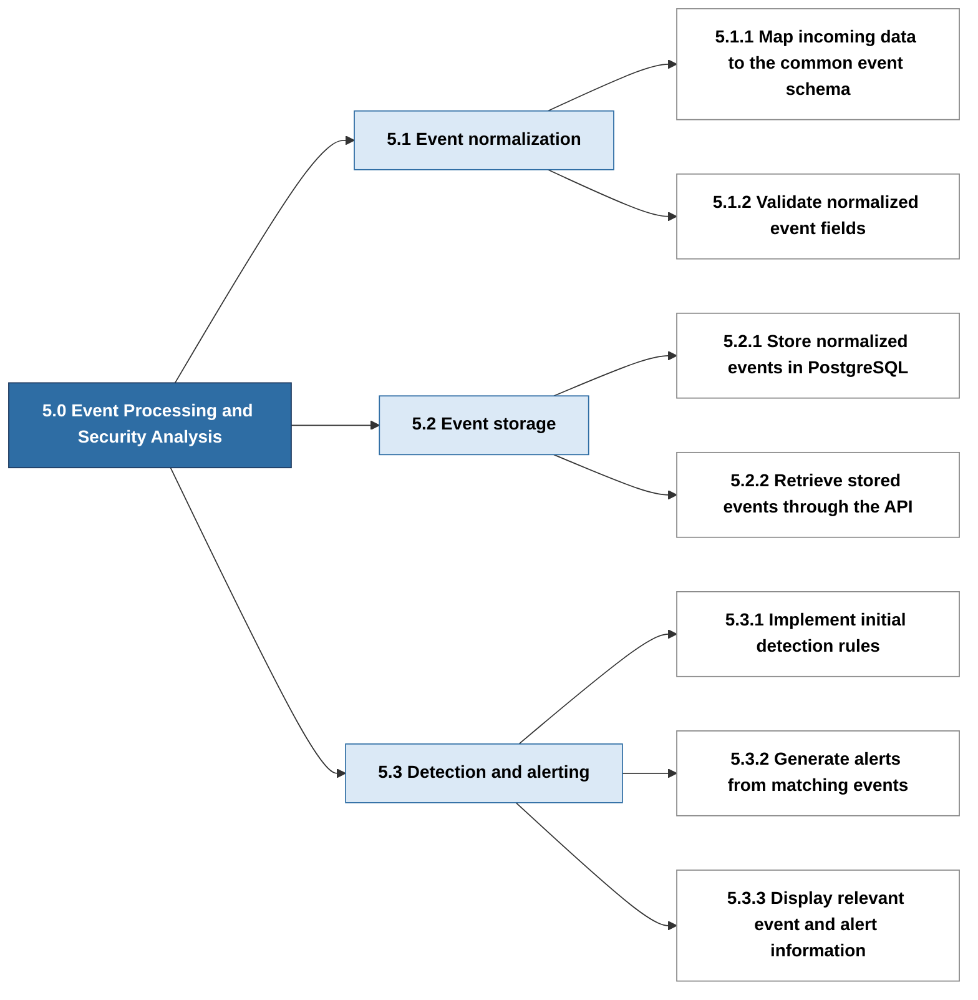
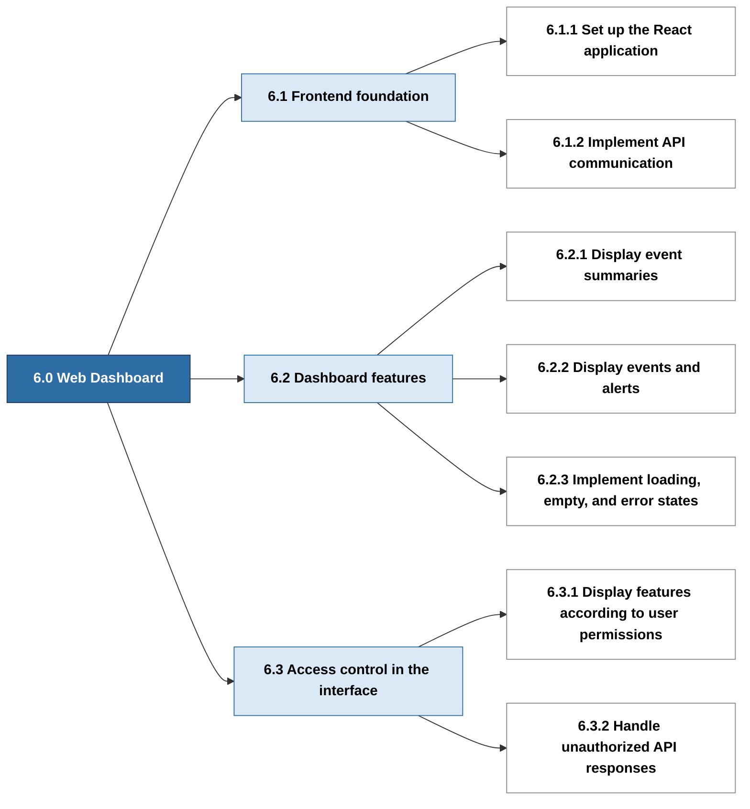
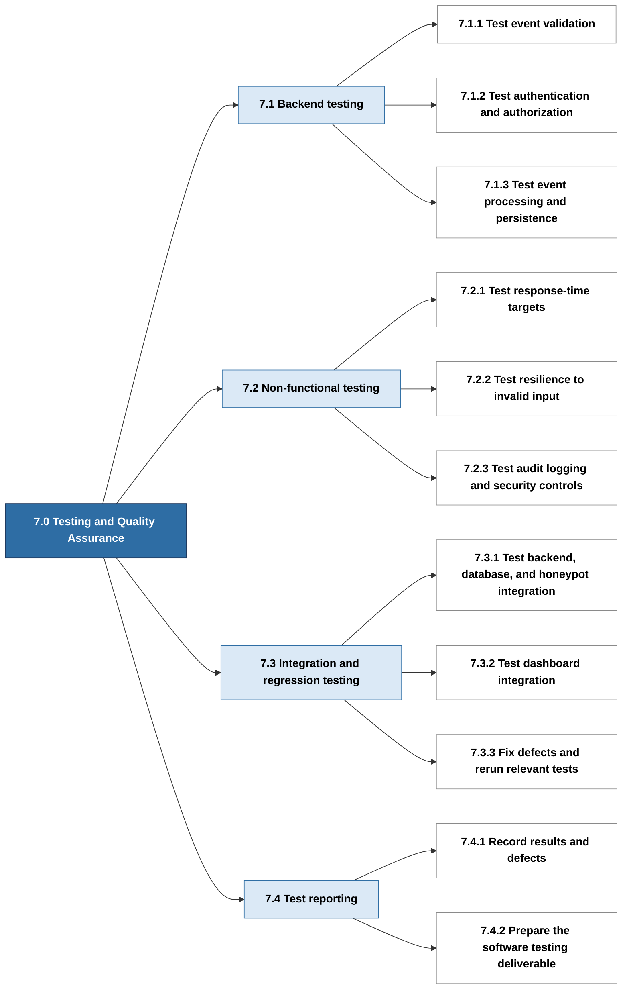
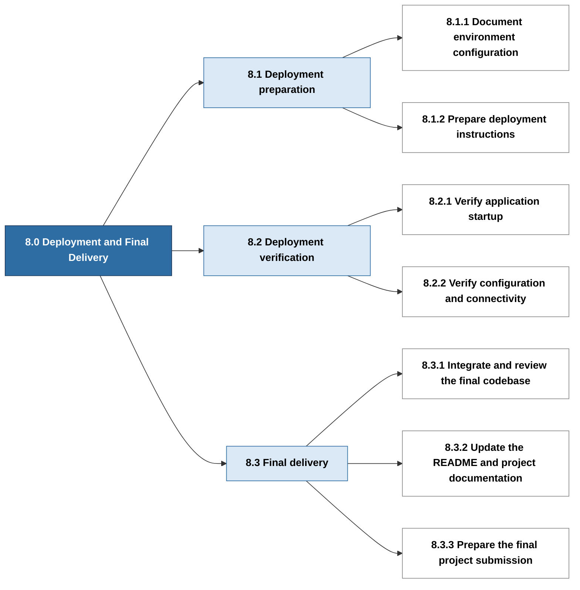
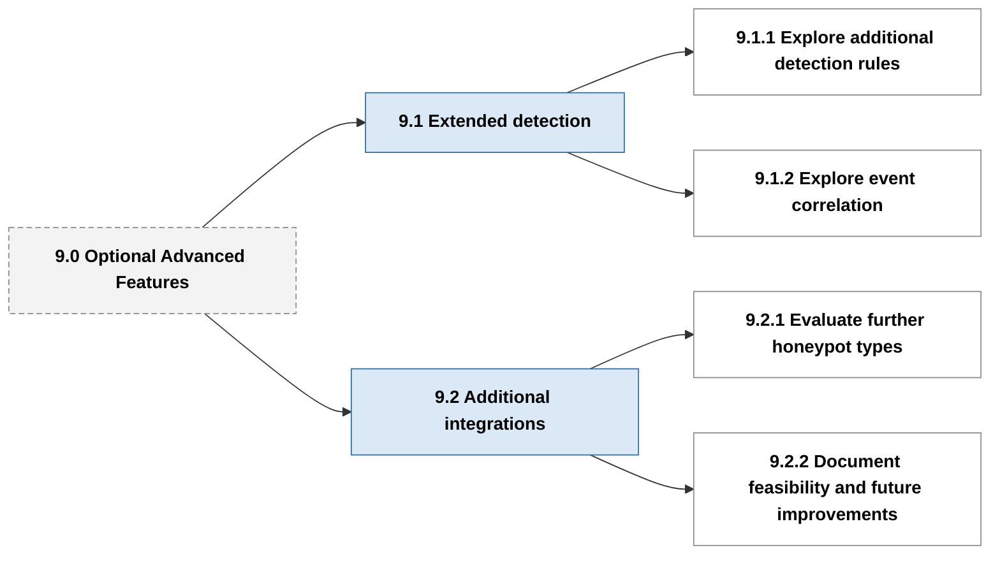

# HIVE Work Breakdown Structure (WBS)

The Work Breakdown Structure (WBS) decomposes the HIVE Honeypot Network project into manageable deliverables and work packages. To keep the diagrams readable, the WBS is shown as one overview diagram followed by one diagram for each major work area.

## WBS Overview

Sections 1.0 to 8.0 are the planned core project work. Section 9.0 (dashed) contains optional advanced features that may be considered after the required deliverables are completed. Optional features must not delay the core deliverables.

## 1.0 Project Management

## 2.0 Requirements and System Design

## 3.0 Platform Foundation

## 4.0 Honeypot Integration

## 5.0 Event Processing and Security Analysis

## 6.0 Web Dashboard

## 7.0 Testing and Quality Assurance

## 8.0 Deployment and Final Delivery

## 9.0 Optional Advanced Features

## WBS Interpretation

- Level 1: The complete HIVE Honeypot Network project.
- Level 2: Major project work areas, numbered 1.0 through 9.0.
- Level 3: Subdivisions of each major work area (for example 3.1).
- Level 4: Individual work packages describing specific activities or deliverables (for example 3.1.1).

The WBS describes the scope and decomposition of project work. Task durations, dependencies, slack, and the critical path are documented separately in the PERT planning document. The project schedule is documented in the Gantt chart.

## Scope and Planning Notes

The WBS identifies planned work and does not, by itself, confirm that any task has been completed. Implementation status and testing evidence should be recorded separately. The PERT and Gantt documents should use the same task identifiers (for example 3.1.1) so that work packages can be traced across the planning documents.
